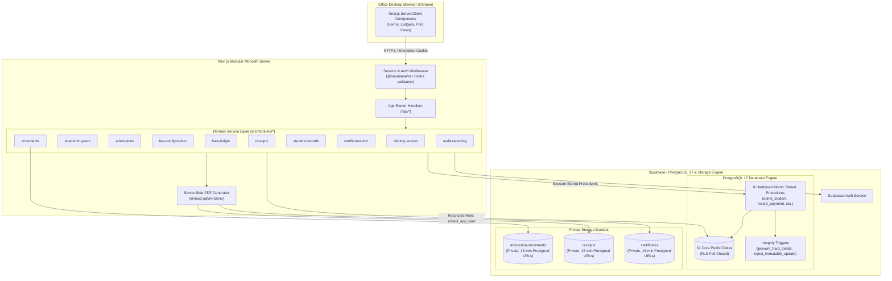

# Architecture and Technical Design

**Status:** Reviewed & Approved for Implementation Baseline (Phase 1 Lock)  
**Document Code:** ARCH-001  
**Project:** School Admission & Fee Management Portal  
**Target Organization:** ABC English Medium School  
**Baseline References:** Signed BRD v1.4, Signed SRS v1.4 (Approved 22 October 2026), ADR-001, CTO Database Audit (`docs/CTO_DATABASE_AUDIT.md`)  
**Implementation Owner:** Senior Software Engineer  

---

## 1. Architectural Principles & System Design Goals

1. **Satisfy Signed Requirements First:** All technical patterns strictly serve the signed BRD/SRS v1.4. No speculative microservices, payment gateways, or distributed infrastructure are introduced.
2. **Modular Monolith Delivery Shell:** A single deployable Next.js (App Router) application pairing server-rendered UI components with isolated domain service modules under `src/modules/*`.
3. **Defense-in-Depth & US-33 AC2 Least Privilege:**
   - Client-facing requests are authenticated via `@supabase/ssr` with HTTP-only cookies.
   - The application server mediates all business logic and authorizes actions against `AUTHORIZATION_MATRIX.md`.
   - Normal operational queries to PostgreSQL execute under a dedicated restricted application role (`school_app_user`) possessing **zero DELETE permissions** and **zero UPDATE permissions on financial ledgers/audit trails**.
   - Atomic business transactions execute via hardened PostgreSQL stored procedures (`SECURITY DEFINER`, `search_path = ''`, owned by `school_app_definer`).
4. **Exact Decimal Monetary Arithmetic:** Zero floating-point arithmetic across UI, API, and database. All financial figures use exact decimal representations (`numeric(10,2)` in PostgreSQL; integer paise or exact decimal representation in Node.js).
5. **Clean Handover Boundary:** Intallo delivers verified source code, automated test suites, setup scripts, and a containerized handover package. ABC English Medium School and the Client own hosting, backups, and live operational management.

---

## 2. System Architecture & Component Interactions

---

## 3. Domain Modules & Responsibilities

| Module Directory | Primary Responsibility | Key Invariants Enforced |
|---|---|---|
| `src/modules/identity-access/` | Staff authentication, session validation, role enforcement, lockout policy. | Deny by default. 5 failed logins -> 15 min lockout. SYSADMIN prohibited from business approvals. |
| `src/modules/academic-years/` | Academic calendar lifecycles (planning, current, closed), settings. | Only one current year. Closed years are read-only (reject writes with 422). No fee carry-forward. |
| `src/modules/admissions/` | Admission intake, draft forms, document checklists, seat limits, Principal review. | Admission approval requires ZERO fee payment. Variable Admission Fee. Seat capacity enforced. |
| `src/modules/fee-configuration/` | Receipt types, fee heads, annual grade fee structures, vehicle place tariffs. | Fee heads segregated into 3 categories (`school_fee`, `vehicle`, `books`). Principal approval required. |
| `src/modules/fees-ledger/` | Student fee assessments, offline payments, allocation engine, concessions, reversals. | Single fee category per payment. Fixed heads cannot be overpaid. Allocation sum == payment amount. Exact INR decimal math. |
| `src/modules/receipts/` | Monotonic sequential numbering, receipt snapshots, final receipt, statement of account. | Monotonic sequence `RCT-YYYY-NNNNNN` (**6 digits**). Final receipt issued strictly at ₹0.00 dues. Payer signature line required. |
| `src/modules/student-records/` | Student directory, search, profiles, parent linkages, student status transitions. | Exactly one primary guardian contact. No hard delete. Annual LC/TC issuance does not mark student Left. |
| `src/modules/certificates-lctc/` | Annual LC/TC pre-population, two-step verification, issuance, reprint tracking. | Format `TC-YYYY-NNNN`. One active certificate per student per year. Principal sign-off required. |
| `src/modules/documents/` | Private file upload, MIME validation, presigned URL generation, document audit. | Completely private storage buckets. Presigned URLs expire in 900 seconds (15 minutes). Audit on download. |
| `src/modules/audit-reporting/` | System-wide append-only audit trail, operational dashboard metrics, dues reports. | Zero update/delete on audit logs. Reports derived strictly from source financial ledger. |

---

## 4. Required Identifier Formats

All numbering schemes are generated atomically from monotonic database counters and must match signed SRS specifications:

1. **Application Number:** `{sequence}/{academic_year_label}` (e.g. `161/2026-27`).
2. **Admission Number:** `ADM-YYYY-NNNN` (e.g. `ADM-2026-0001`).
3. **Receipt Number:** `RCT-YYYY-NNNNNN` (e.g. `RCT-2026-000001`, **6 zero-padded digits**).
4. **Transfer Certificate Number:** `TC-YYYY-NNNN` (e.g. `TC-2026-0001`).

---

## 5. Security & Authorization Boundary

### 5.1 Role-Based Access Control (RBAC)
Authoritative permissions follow signed SRS §2.2 and `docs/DECISION_AND_RISK_REGISTER.md`:
- **Principal (Institutional Authority):** Sole authority for admission approvals, fee concessions, payment reversals, fee structure approvals, certificate release, and student status changes to Left/Transferred.
- **System Administrator (Technical Operator):** Technical operator managing user accounts and infrastructure. Strictly prohibited from admission approvals, fee concessions, payment recording, ledger overrides, and sensitive PII access.
- **Admission Officer / Clerk (ADM):** Intake forms, document verification, draft admissions, certificate drafts.
- **Accountant (ACC):** Offline payment recording, receipt issuance, dues inquiry, financial statements. Cannot approve concessions or reversals.
- **Read Only:** View-only access to non-sensitive student and academic summaries.

### 5.2 US-33 AC2 Database Privilege Boundary
To prevent any possibility of database tampering and satisfy US-33 AC2:
- An application database role `school_app_user` is provisioned.
- `REVOKE DELETE ON ALL TABLES IN SCHEMA public FROM school_app_user;`
- `REVOKE UPDATE ON public.payments, public.payment_allocations, public.receipts, public.consolidated_receipts, public.certificate_versions, public.audit_logs FROM school_app_user;`
- Complex mutations and atomic financial allocations execute through hardened stored procedures with `SECURITY DEFINER` and empty `search_path`.
