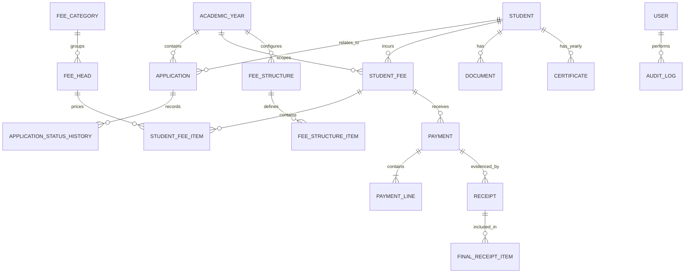

# Logical Data Model

**Derived from SRS v1.4 Section 6.1. This is not SQL or a migration.** M0.4 must inventory the actual schema read-only; reconcile differences through M1 ADR before any change.

| Entity | Key concepts |
|---|---|
| User | Username, hashed password, role, active, must-change-password. |
| AcademicYear | Label, start/end, is_current, Open/Closed. |
| Standard/Section | Standard name/order, broad section, optional minimum age (rules open). |
| SeatLimit | Year, section, maximum, actor and timestamp (unit of 100 is open). |
| Student / StudentSensitive | Student identity/address/STS; sensitive Aadhaar/caste/sub-caste/certificate and bank fields encrypted by application. |
| Parent/Guardian / ParentSensitive | Parent names, contacts, occupation where required; income is sensitive. |
| Application / ApplicationStatusHistory | No/date/year/standard/placement/status/transport/prior-school/admission details and decision log. |
| Document / DocumentType / DocumentRequirement | Versioned private file ref, uploader/date, type and per-section requirement. |
| TransportRoute/place | Place name/active state; tariff basis open. |
| FeeCategory / FeeHead | Receipt type and head; Fixed/Variable, Admission Fee flag, order and active state. |
| FeeStructure / FeeStructureItem | Year/version/approval and amount by standard/head/place as applicable. |
| StudentFee / StudentFeeItem | Student/year/structure and head-level assigned charges/source. |
| Adjustment | One-head concession/reduction/extra charge/exception, amount/reason/requester/approver/status. |
| Payment / PaymentLine / PaymentCorrection | Year, receipt type, Payment/Reversal/Refund, amount/date/mode/reference/payer/collector/original linkage; head-level lines and correction approvals. |
| Receipt / FinalReceiptItem / DocumentPrint | Number/kind/snapshot; consolidated receipt numbers; print/reprint actor/time/duplicate flag. |
| TCRequest / Certificate | Student/year/reason/step approvals/TC number/issue date/snapshot. |
| NumberSequence | Type/year/prefix/digits/template/counter. |
| AuditLog | Actor/action/entity/allowed before-after data/timestamp; no sensitive values. |

## Integrity rules
1. Receipt and certificate contents are immutable snapshots at issue time.
2. Foreign keys do not cascade-delete core history.
3. Sensitive fields are separated for access and encrypted where required.
4. Number allocated in same transaction as record; committed numbers unique and never reused.
5. Payment line amounts sum to total at commit and lines match payment receipt type.
6. Fee totals/status derived through one authoritative calculation, not independently editable.
7. Payment ledger, receipts and audit log cannot be edited/deleted by normal application paths; database role permissions reinforce this.
8. Year-specific records are scoped explicitly; no automatic carry-forward.

## Relationship sketch

This is a logical model only; M0.4 must record actual table/column/constraint/policy facts without modification.
