# System Architecture and REST API Reference (Phase 7 Handover)

**Document Code:** P7-ARCH-API-001  
**Project:** School Admission & Fee Management Portal  
**Target Organization:** ABC English Medium School  
**Architecture Pattern:** Modular Monolith with Server-Side Mediation (ADR-001)  
**Framework Stack:** Next.js 14 (App Router), TypeScript 5.6.3, Tailwind CSS, React 18, Supabase / PostgreSQL 15+  
**Verification Date:** 29 October 2026  
**Status:** **Audited & Verified**  

---

## 1. High-Level System Architecture

The application is engineered as a **Modular Monolith with Server-Side Mediation** ([ADR-001](file:///docs/adr/ADR-001-modular-monolith.md)). The browser client communicates strictly with Next.js API route handlers; direct client connections to the database are blocked by fail-closed Row Level Security (RLS).

```mermaid
flowchart TD
    subgraph CLIENT["Client Tier (Desktop Browser - Chrome)"]
        UI_ADM["/admissions (Admissions Page)"]
        UI_FEES["/fees (Fees & Billing Page)"]
        UI_RCT["/receipts (Receipts & History)"]
        UI_CERT["/certificates (LC/TC Portal)"]
        UI_STUD["/students (Student Directory)"]
        UI_AUD["/audit (Audit Log Viewer)"]
        UI_DASH["/ (Executive Dashboard)"]
    end

    subgraph SERVER["Application Server Tier (Next.js 14 App Router)"]
        MIDDLE["Session & Auth Guards (src/auth/guards.ts)"]
        POLICY["Centralized Policy Engine (src/policy/guards.ts)"]
        VAL["Zod Validation Layer (src/validation/*)"]
        
        subgraph MODULES["Domain Services Tier (src/modules/*)"]
            M_ID["identity-access"]
            M_AY["academic-years"]
            M_ADM["admissions"]
            M_DOC["documents"]
            M_CONF["fee-configuration"]
            M_FEES["fees-ledger"]
            M_RCT["receipts"]
            M_STUD["student-records"]
            M_CERT["certificates-lctc"]
            M_AUD["audit-reporting"]
        end
    end

    subgraph DATA["Database Tier (PostgreSQL 15+ / Supabase)"]
        DB_MUT["Mutable Domain Tables<br>(students, applications, fee_heads)"]
        DB_IMMUT["Immutable Ledger & Audit Tables<br>(payments, allocations, receipts, audit_logs)"]
        DB_TRIG["Integrity Triggers & Stored Procedures<br>(prevent_hard_delete, reject_immutable_update)"]
        DB_ROLE["Restricted Role: school_app_user (US-33 AC2)"]
    end

    CLIENT -->|HTTPS / REST API| MIDDLE
    MIDDLE --> POLICY
    POLICY --> VAL
    VAL --> MODULES
    MODULES -->|Service Role / Restricted User| DATA
```



---

## 2. Domain Module Decomposition (`src/modules/*`)

1. **`identity-access`:** Staff authentication via scrypt hashes, session token signing with cryptographic integrity, 5-attempt/15-minute lockout (US-01 AC3), password change policies, and staff directory management.
2. **`academic-years`:** Academic year calendar lifecycle (`planning`, `current`, `closed`), June 1 to May 31 bounds check, single current year constraint, and strict annual accounting isolation (DEC-06).
3. **`admissions`:** Multi-step application intake (draft, submitted, under-review, on-hold, approved, rejected), document checklist verification, section capacity enforcement (US-42, REG-02), atomic admission approval (US-15), permanent admission number generation (`ADM-YYYY-NNNN`). **Zero payment prerequisite** (DEC-01).
4. **`documents`:** File upload validation (PDF, JPG, PNG, max 5MB per file), document ownership isolation, presigned download URL generation, and missing document tracking.
5. **`fee-configuration`:** Fee heads classified into `school_fee`, `vehicle`, and `books` (DEC-10); yearly fee structure draft and Principal approval workflow (REG-05); vehicle transport rates by destination place (REG-06, US-19).
6. **`fees-ledger`:** Offline payment recording (cash, cheque, bank transfer, UPI manual; DEC-02); single fee category per payment (DEC-10); exact decimal INR allocations; concessions with Principal approval (US-26); payment reversals (US-26A); dynamic student dues calculation (US-23).
7. **`receipts`:** Shared monotonic sequential receipt numbering (`RCT-YYYY-NNNNNN`, 6 zero-padded digits; DEC-03, US-27); standard PDF-1.4 rendering with Payer, Cashier, and Manager signature lines (DEC-05); duplicate reprint watermarks (US-29); Final Fees Receipt issued strictly at net balance ₹0.00 (DEC-04, US-28).
8. **`student-records`:** Search students by admission number, name, STS, or DISE; single-pane student profile; status transition to `left`/`transferred`/`withdrawn` (US-32); sensitive PII protection (DPDP Act, US-03, R-06).
9. **`certificates-lctc`:** Pre-population of annual draft LC/TC records (US-34); two-step issuance workflow (Step 1 Admission Officer review, Step 2 Principal approval; US-35); unpaid dues warning and mandatory Principal override justification (REG-03); monotonic `TC-YYYY-NNNN` numbering (US-36); student enrollment status preserved upon issuance (DEC-08).
10. **`audit-reporting`:** Append-only immutable audit trail (US-38); before/after diff tracking; executive dashboard metrics aggregating enrollment, seat capacity utilization, fee collections, and dues (US-39).

---

## 3. Cross-Cutting Engineering Standards

### 3.1 Error Handling & RFC 7807 Compliance
All API route handlers return error responses adhering to the **RFC 7807 Problem Details** standard via [`src/lib/errors.ts`](file:///src/lib/errors.ts):
```json
{
  "type": "https://school.example/errors/business-rule-violation",
  "title": "Business Rule Violation",
  "status": 422,
  "code": "FINAL_RECEIPT_DUES_EXIST",
  "detail": "Final fees receipt cannot be issued. Student has an outstanding balance of INR 4,500.00.",
  "correlationId": "corr-1730209800-abc1234",
  "instance": "/api/v1/receipts/final"
}
```
Internal server errors (500) automatically redact stack traces and database credentials to prevent secret leakage.

### 3.2 Exact Decimal Currency Math (DEC-11, SBR-03)
All currency calculations are performed using [`decimal.js`](file:///src/lib/money/inr.ts) with 20-digit precision and `ROUND_HALF_UP` rounding. Floating-point binary representation is strictly prohibited. Amounts are stored as `numeric(10,2)` in PostgreSQL and represented as validated decimal strings (`DecimalInrString`) in TypeScript.

---

## 4. Complete REST API Route Reference

### 4.1 Authentication & Staff Administration
- `POST /api/v1/auth/login`: Authenticates staff credentials; returns session cookie.
- `POST /api/v1/auth/logout`: Revokes active session.
- `GET /api/v1/auth/me`: Resolves current authenticated session and role permissions.
- `POST /api/v1/auth/change-password`: Changes user password.
- `GET /api/v1/admin/staff`: (`system_admin` only) Lists all staff members.
- `POST /api/v1/admin/staff`: (`system_admin` only) Provisions a new staff member.
- `PATCH /api/v1/admin/staff/[id]`: (`system_admin` only) Updates staff active state or role.
- `POST /api/v1/admin/staff/[id]/reset-password`: (`system_admin` only) Triggers password reset.

### 4.2 Academic Years & Calendar
- `GET /api/v1/academic-years`: Lists all academic years.
- `POST /api/v1/academic-years`: (`principal` only) Creates a new academic year.
- `POST /api/v1/academic-years/select`: Updates the active academic year in user session.
- `POST /api/v1/academic-years/[id]/close`: (`principal` only) Freezes and closes an academic year.

### 4.3 Admissions & Document Management
- `GET /api/v1/admissions/applications`: Lists applications filtered by status and year.
- `POST /api/v1/admissions/applications`: (`admission_officer` only) Creates a new draft application.
- `GET /api/v1/admissions/applications/[id]`: Retrieves full application detail and status timeline.
- `PATCH /api/v1/admissions/applications/[id]`: Updates draft applicant information.
- `POST /api/v1/admissions/applications/[id]/submit`: (`admission_officer` only) Submits application for review.
- `POST /api/v1/admissions/applications/[id]/hold`: (`principal` only) Places application on hold with reason.
- `POST /api/v1/admissions/applications/[id]/reject`: (`principal` only) Rejects application with reason.
- `POST /api/v1/admissions/applications/[id]/return-to-draft`: Returns application to draft.
- `POST /api/v1/admissions/applications/[id]/approve`: (`principal` only) **Operation 1**: Approves admission, assigns section, assigns permanent `ADM-YYYY-NNNN`, generates assessment lines. Zero payment gate.
- `GET /api/v1/admissions/capacity`: Returns real-time section seat capacity utilization.
- `POST /api/v1/documents/upload`: Uploads applicant verification document (PDF, JPG, PNG < 5MB).
- `GET /api/v1/documents/applications/[applicationId]`: Retrieves document checklist.
- `GET /api/v1/documents/[id]/download-url`: Generates secure presigned download URL.

### 4.4 Fee Configuration & Tariffs
- `GET /api/v1/fee-config/heads`: Lists fee heads.
- `POST /api/v1/fee-config/heads`: (`accountant` only) Creates new fee head (`school_fee`, `vehicle`, `books`).
- `GET /api/v1/fee-config/structures`: Lists yearly fee structures.
- `POST /api/v1/fee-config/structures`: (`accountant` only) Creates draft fee structure for a grade level.
- `POST /api/v1/fee-config/structures/[id]/approve`: (`principal` only) Formally approves annual fee structure.
- `GET /api/v1/fee-config/transport-rates`: Lists transport destination rates.
- `POST /api/v1/fee-config/transport-rates`: (`accountant` only) Configures vehicle route tariff by place.

### 4.5 Fees Ledger, Payments & Receipts
- `GET /api/v1/students/[id]/dues`: Calculates exact student dues breakdown.
- `POST /api/v1/fees/payments`: (`accountant` only) **Operation 2**: Records offline fee payment and allocations. Assigns `RCT-YYYY-NNNNNN`.
- `POST /api/v1/fees/payments/[id]/reversal`: (`principal` only) **Operation 4**: Records non-destructive reversal.
- `POST /api/v1/fees/adjustments`: (`accountant` or `principal`) Requests fee concession.
- `POST /api/v1/fees/adjustments/[id]/approve`: (`principal` only) **Operation 3**: Formally approves fee waiver.
- `GET /api/v1/reports/dues`: Generates outstanding dues report grouped by section and grade.
- `GET /api/v1/receipts/[id]`: Retrieves receipt snapshot.
- `GET /api/v1/receipts/[id]/pdf`: Streams official PDF-1.4 receipt document.
- `POST /api/v1/receipts/[id]/reprint`: Re-issues receipt with duplicate watermark.
- `POST /api/v1/receipts/final`: (`accountant` only) **Operation 6**: Issues Final Fees Receipt (strictly at ₹0.00 dues).
- `GET /api/v1/receipts/statement/[id]`: Generates printable Statement of Account.

### 4.6 Student Records & Certificates
- `GET /api/v1/students`: Searches students by name, admission number, STS, or DISE.
- `GET /api/v1/students/[id]`: Retrieves comprehensive student profile.
- `POST /api/v1/students/[id]/status`: (`principal` only) **Operation 8**: Marks student left, transferred, or withdrawn.
- `GET /api/v1/certificates`: Lists Transfer Certificates.
- `POST /api/v1/certificates`: Requests Transfer Certificate.
- `POST /api/v1/certificates/prepopulate`: (`admission_officer` only) Batch pre-populates draft annual certificates.
- `POST /api/v1/certificates/[id]/review`: (`admission_officer` only) Step 1 review of conduct and remarks.
- `POST /api/v1/certificates/[id]/issue`: (`principal` only) **Operation 7**: Step 2 Principal approval & TC issuance.
- `POST /api/v1/certificates/[id]/reprint`: Re-issues certificate with duplicate banner.

### 4.7 Audit Logs & Dashboard
- `GET /api/v1/audit-logs`: (`principal` & `system_admin`) Queries append-only audit trail.
- `GET /api/v1/dashboard/metrics`: Generates real-time operational aggregates for dashboard widgets.
- `GET /api/health`: Health check endpoint for host monitoring.
