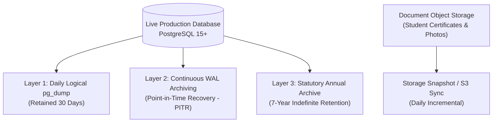

# Database Backup and Disaster Recovery Guide (Phase 7 Handover)

**Document Code:** P7-BACKUP-RESTORE-001  
**Project:** School Admission & Fee Management Portal  
**Target Organization:** ABC English Medium School  
**Operational Owner:** Client System Administrator & Infrastructure Team  
**Verification Date:** 29 October 2026  
**Status:** **Handover Runbook (Client-Operated Environment)**  

---

## 1. Client Operational Responsibility Boundary

In accordance with signed BRD v1.4 §13 and signed SRS v1.4 §1.3:
- **Intallo (Vendor):** Delivers verified source code, database migration scripts, and operational guidance. Intallo does not operate live infrastructure or execute ongoing backups.
- **ABC English Medium School (Client):** Owns and operates the live production database, hosting environment, network boundaries, and backup schedules. The school's IT administrator must establish, monitor, and test regular automated backups.

---

## 2. Recommended Backup Strategy

A defense-in-depth backup strategy comprising three layers is strongly recommended for institutional compliance:



### 2.1 Layer 1: Daily Logical Backups (`pg_dump`)
- **Frequency:** Every night at 01:00 AM IST (off-peak hours).
- **Format:** Custom archive format (`-F c`), compressed, including all schemas (`public` and `private`).
- **Retention:** Rolling 30-day retention on a physically separate server or secure cloud bucket.

### 2.2 Layer 2: Continuous WAL Archiving (Point-in-Time Recovery - PITR)
- If operating on managed PostgreSQL (e.g. Supabase Pro, AWS RDS, Google Cloud SQL), enable automated WAL archiving with 7-day minimum PITR.
- Enables restoring the database to the exact minute prior to any accidental disaster or hardware corruption.

### 2.3 Layer 3: Statutory 7-Year Financial Archive (REG-18)
- Under Indian statutory financial accounting guidelines, educational institutions must retain financial ledgers and receipts for at least **7 fiscal years**.
- At the close of each academic year (May 31), generate an encrypted, immutable year-end database dump.

---

## 3. Automated Backup Script Templates

### 3.1 Linux / Bash Backup Script (`backup_school_portal.sh`)
```bash
#!/bin/bash
set -euo pipefail

# Configuration
DB_HOST="127.0.0.1"
DB_PORT="5432"
DB_NAME="school_portal_prod"
DB_USER="postgres"
BACKUP_DIR="/var/backups/school_portal"
DATE_STAMP=$(date +"%Y%m%d_%H%M%S")
BACKUP_FILE="${BACKUP_DIR}/school_portal_${DATE_STAMP}.dump"

# Ensure backup directory exists
mkdir -p "${BACKUP_DIR}"

echo "[INFO] Starting database backup at $(date)..."
PGPASSWORD="${PGPASSWORD:-postgres}" pg_dump \
  -h "${DB_HOST}" \
  -p "${DB_PORT}" \
  -U "${DB_USER}" \
  -d "${DB_NAME}" \
  -F c \
  -b \
  -v \
  -f "${BACKUP_FILE}"

echo "[INFO] Backup successfully written to ${BACKUP_FILE}"

# Enforce 30-day retention policy: remove older backups
find "${BACKUP_DIR}" -type f -name "school_portal_*.dump" -mtime +30 -delete
echo "[INFO] Cleaned backups older than 30 days."
```

### 3.2 Windows PowerShell Backup Script (`backup_school_portal.ps1`)
```powershell
$ErrorActionPreference = "Stop"

$DB_HOST = "127.0.0.1"
$DB_PORT = "54322"
$DB_NAME = "postgres"
$DB_USER = "postgres"
$BACKUP_DIR = "C:\Backups\SchoolPortal"
$DATE_STAMP = Get-Date -Format "yyyyMMdd_HHmmss"
$BACKUP_FILE = "$BACKUP_DIR\school_portal_$DATE_STAMP.dump"

if (!(Test-Path $BACKUP_DIR)) {
    New-Item -ItemType Directory -Path $BACKUP_DIR -Force | Out-Null
}

Write-Host "[INFO] Starting database backup to $BACKUP_FILE..."
& pg_dump -h $DB_HOST -p $DB_PORT -U $DB_USER -d $DB_NAME -F c -b -v -f $BACKUP_FILE

Write-Host "[INFO] Backup completed successfully."

# Purge backups older than 30 days
Get-ChildItem -Path $BACKUP_DIR -Filter "school_portal_*.dump" | Where-Object {
    $_.CreationTime -lt (Get-Date).AddDays(-30)
} | Remove-Item -Force
```

---

## 4. Disaster Recovery & Restoration Runbook

In the event of a catastrophic host failure or corruption, follow this step-by-step recovery runbook:

### Step 1: Provision Clean PostgreSQL Instance
Ensure target PostgreSQL 15+ is installed and listening. Create a fresh, empty database:
```sql
CREATE DATABASE school_portal_prod WITH ENCODING 'UTF8';
```

### Step 2: Restore Schema and Data from Dump File
Using `pg_restore`:
```bash
# -c drops existing objects before recreating them; -e exits on error; -v is verbose
pg_restore -h 127.0.0.1 -p 5432 -U postgres -d school_portal_prod -c -v "/path/to/school_portal_backup.dump"
```

### Step 3: Verify Role Grants and Least-Privilege Role
Verify that the `school_app_user` role exists and retains proper permissions:
```sql
SELECT rolname FROM pg_roles WHERE rolname = 'school_app_user';
```
If missing, re-apply [`supabase/migrations/20261030000000_provision_restricted_app_role.sql`](file:///supabase/migrations/20261030000000_provision_restricted_app_role.sql).

### Step 4: Execute Post-Restore Integrity Verification
Run the automated verification suite against the restored database:
```bash
psql -h 127.0.0.1 -p 5432 -U postgres -d school_portal_prod -f supabase/tests/integrity_tests.sql
psql -h 127.0.0.1 -p 5432 -U postgres -d school_portal_prod -f supabase/tests/us33_ac2_least_privilege_tests.sql
```
Verify that all assertions return `pass`.

### Step 5: Restore Uploaded Document Files
Restore uploaded documents to the designated object store or storage directory (`/var/data/school_documents` or S3 bucket) and verify that permissions are restricted to the application service account.
