# Database Schema & Data Inventory (Milestone M0.4)

**Document Code:** M0.4 — Database Schema & Data Inventory  
**Task Owner:** Ujwal (Admissions & Student Records Owner)  
**Assigned Reviewer:** Shashidhar (Project Lead & Architecture Owner)  
**Inspection Type:** Strictly Read-Only Discovery  
**Baseline Commit:** `5e1c47e` (incorporating hardening migration `20261022090000`)  
**Database Safety Attestation:** Strictly **Read-Only** — zero database writes, resets, migrations, or reseed operations were performed against the retained database (`fjrfyzamiirqzitdchkz`). Zero live student, parent, or financial records are contained in this inventory.  

---

## 1. Executive Summary & Read-Only Methodology

This deliverable provides an exhaustive, read-only architectural audit of the existing Supabase / PostgreSQL database supporting the **School Admission & Fee Management Portal**.

### 1.1 Methodology & Safety Boundary
1. **Source of Truth:** Audited directly from repository schema definitions (`supabase/migrations/`), synthetic seed dataset (`supabase/seed.sql`), generated TypeScript schema types ([`src/types/database.types.ts`](file:///C:/Users/shash/OneDrive/Desktop/PROJECTS/Admission-Fee-Management-Portal/src/types/database.types.ts)), and non-destructive verification queries ([`supabase/tests/verification.sql`](file:///C:/Users/shash/OneDrive/Desktop/PROJECTS/Admission-Fee-Management-Portal/supabase/tests/verification.sql)).
2. **Zero Mutation Guarantee:** No database modification commands (`INSERT`, `UPDATE`, `DELETE`, `DROP`, `ALTER`, `TRUNCATE`, `supabase db reset`, or migration runs) were issued against the retained project database.
3. **Privacy Compliance:** All row counts and entity structures documented herein are derived from synthetic development seeds. No real student, parent, or financial records are copied or exported.
4. **Fact vs. Proposal Distinction:** Observed database facts (existing tables, keys, triggers, fail-closed RLS) are strictly separated from required application features and open design decisions.

---

## 2. Core Domain Mapping & Entity-Relationship Architecture

The existing database contains **31 public tables**, which map into 7 core functional domains:

```mermaid
erDiagram
    %% 1. ACADEMIC STRUCTURE & CALENDAR
    academic_years ||--o{ sections : "contains"
    academic_years ||--o{ transport_rates : "defines"
    academic_years ||--o{ fee_structures : "schedules"
    academic_years ||--o{ student_academic_records : "scopes"
    academic_years ||--o{ admission_applications : "applies_to"
    academic_years ||--o{ document_requirements : "configures"
    grade_levels ||--o{ sections : "has"
    grade_levels ||--o{ fee_structures : "applies_to"
    grade_levels ||--o{ student_academic_records : "enrolled_in"
    grade_levels ||--o{ admission_applications : "requests"
    grade_levels ||--o{ document_requirements : "configures"

    %% 2. STAFF & IDENTITY
    staff_members ||--o{ admission_applications : "creates/reviews"
    staff_members ||--o{ admission_status_history : "records_change"
    staff_members ||--o{ fee_structures : "creates/approves"
    staff_members ||--o{ student_fee_assessments : "issues"
    staff_members ||--o{ payments : "records"
    staff_members ||--o{ fee_adjustments : "requests/approves"
    staff_members ||--o{ receipts : "issues"
    staff_members ||--o{ consolidated_receipts : "generates"
    staff_members ||--o{ student_documents : "uploads/reviews"
    staff_members ||--o{ student_year_certificates : "generates/approves"
    staff_members ||--o{ certificate_versions : "generates/approves"
    staff_members ||--o{ audit_logs : "triggers"

    %% 3. STUDENTS, GUARDIANS & ACADEMIC RECORDS
    students ||--o{ student_guardians : "linked_to"
    guardians ||--o{ student_guardians : "has"
    students ||--|| student_sensitive_details : "owns"
    students ||--o{ student_academic_records : "enrolled_as"
    students ||--o{ admission_applications : "submits"
    students ||--o{ student_documents : "provides"
    sections ||--o{ student_academic_records : "allocates"
    student_academic_records ||--o{ student_transport_assignments : "opts_into"
    transport_rates ||--o{ student_transport_assignments : "billed_at"

    %% 4. ADMISSIONS & DOCUMENTS
    admission_applications ||--o{ admission_status_history : "transitions"
    admission_applications ||--o{ student_documents : "attaches"
    document_types ||--o{ document_requirements : "itemizes"
    document_types ||--o{ student_documents : "categorizes"

    %% 5. FEE CONFIGURATION & ASSESSMENTS
    fee_heads ||--o{ fee_structure_lines : "contains"
    fee_heads ||--o{ student_fee_assessment_lines : "assesses"
    fee_structures ||--o{ fee_structure_lines : "specifies"
    fee_structures ||--o{ student_fee_assessments : "generates"
    student_academic_records ||--o{ student_fee_assessments : "billed_statement"
    student_fee_assessments ||--o{ student_fee_assessment_lines : "itemizes"

    %% 6. PAYMENTS, LEDGER & RECEIPTS
    student_academic_records ||--o{ payments : "records_for"
    payments ||--o{ payment_allocations : "splits_into"
    student_fee_assessment_lines ||--o{ payment_allocations : "credits"
    student_fee_assessment_lines ||--o{ fee_adjustments : "adjusted_by"
    payments ||--|| receipts : "receipted_by"
    receipt_number_counters ||--o{ receipts : "sequences"
    student_academic_records ||--o{ consolidated_receipts : "settles"
    consolidated_receipts ||--o{ consolidated_receipt_items : "itemizes"
    receipts ||--o{ consolidated_receipt_items : "summarized_in"

    %% 7. CERTIFICATES & AUDIT
    student_academic_records ||--o{ student_year_certificates : "issues_for"
    student_year_certificates ||--o{ certificate_versions : "versions"
```



---

## 3. Detailed Table-by-Table Schema Inventory (All 31 Tables)

### Domain 1: Academic Structure & Calendar

#### 1. `academic_years`
- **Purpose:** School calendar year definitions (e.g., 2025–2026, 2026–2027) bounding all operations.
- **Columns:**
  - `id` (`uuid`, PK, default: `gen_random_uuid()`)
  - `label` (`text`, NOT NULL, UNIQUE, e.g. `'2026-2027'`)
  - `start_date` (`date`, NOT NULL)
  - `end_date` (`date`, NOT NULL)
  - `status` (`public.academic_year_state`, NOT NULL, default: `'planning'`)
  - `notes` (`text`, nullable)
  - `created_at` (`timestamptz`, NOT NULL, default: `clock_timestamp()`)
  - `updated_at` (`timestamptz`, NOT NULL, default: `clock_timestamp()`)
- **Constraints:**
  - `academic_years_dates_check`: `CHECK (start_date < end_date)`
- **Indexes:**
  - `academic_years_pkey` (`id` PK)
  - `academic_years_label_key` (`label` UNIQUE)
  - `academic_years_single_current_idx` (UNIQUE on `(status)` WHERE `status = 'current'`) — ensures only one year can be active at a time.
- **Triggers:** `private.set_updated_at()`, `private.prevent_hard_delete()`.
- **RLS:** Enabled, fail-closed, grants to `service_role`.

#### 2. `grade_levels`
- **Purpose:** Academic grade standards (Nursery, LKG, UKG, STD1 to STD10).
- **Columns:**
  - `id` (`uuid`, PK, default: `gen_random_uuid()`)
  - `code` (`text`, NOT NULL, UNIQUE, e.g. `'NUR'`, `'STD1'`)
  - `name` (`text`, NOT NULL, e.g. `'Standard 1'`)
  - `group_name` (`public.grade_group`, NOT NULL: `'pre_primary'`, `'primary'`, `'high_school'`)
  - `sort_order` (`smallint`, NOT NULL, default: `10`)
  - `is_active` (`boolean`, NOT NULL, default: `true`)
  - `created_at` (`timestamptz`, NOT NULL, default: `clock_timestamp()`)
  - `updated_at` (`timestamptz`, NOT NULL, default: `clock_timestamp()`)
- **Indexes:** `grade_levels_pkey` (`id`), `grade_levels_code_key` (`code`).
- **Triggers:** `private.set_updated_at()`, `private.prevent_hard_delete()`.

#### 3. `sections`
- **Purpose:** Class sections (e.g. Standard 1 Section A) scoped to an academic year and grade level.
- **Columns:**
  - `id` (`uuid`, PK, default: `gen_random_uuid()`)
  - `academic_year_id` (`uuid`, NOT NULL, FK -> `academic_years.id` ON DELETE RESTRICT)
  - `grade_level_id` (`uuid`, NOT NULL, FK -> `grade_levels.id` ON DELETE RESTRICT)
  - `name` (`text`, NOT NULL, e.g. `'A'`, `'B'`)
  - `max_capacity` (`integer`, NOT NULL, default: `40`)
  - `is_active` (`boolean`, NOT NULL, default: `true`)
  - `created_at` (`timestamptz`, NOT NULL, default: `clock_timestamp()`)
  - `updated_at` (`timestamptz`, NOT NULL, default: `clock_timestamp()`)
- **Constraints:**
  - `sections_max_capacity_check`: `CHECK (max_capacity > 0)`
  - Composite UNIQUE `(academic_year_id, grade_level_id, name)`
- **Indexes:** `sections_pkey`, `sections_academic_year_id_grade_level_id_name_key`, `sections_grade_idx`.
- **Triggers:** `private.set_updated_at()`, `private.prevent_hard_delete()`.

#### 4. `transport_rates`
- **Purpose:** Vehicle tariff rates mapped to geographic places and transport modes.
- **Columns:**
  - `id` (`uuid`, PK, default: `gen_random_uuid()`)
  - `academic_year_id` (`uuid`, NOT NULL, FK -> `academic_years.id` ON DELETE RESTRICT)
  - `mode` (`public.transport_mode`, NOT NULL: `'school_bus'`, `'private_vehicle'`)
  - `place_label` (`text`, NOT NULL, e.g. `'Jayanagar'`)
  - `amount` (`numeric(10,2)`, NOT NULL)
  - `is_active` (`boolean`, NOT NULL, default: `true`)
  - `created_at` (`timestamptz`, NOT NULL, default: `clock_timestamp()`)
  - `updated_at` (`timestamptz`, NOT NULL, default: `clock_timestamp()`)
- **Constraints:**
  - `transport_rates_amount_check`: `CHECK (amount >= 0)`
  - Composite UNIQUE `(academic_year_id, mode, place_label)`
- **Indexes:** `transport_rates_pkey`, `transport_rates_academic_year_id_mode_place_label_key`.
- **Triggers:** `private.set_updated_at()`, `private.prevent_hard_delete()`.

---

### Domain 2: Staff & Identity

#### 5. `staff_members`
- **Purpose:** Directory of authorized school staff members and administrative roles.
- **Columns:**
  - `id` (`uuid`, PK, default: `gen_random_uuid()`)
  - `auth_user_id` (`uuid`, nullable, UNIQUE, FK -> `auth.users.id` ON DELETE SET NULL)
  - `full_name` (`text`, NOT NULL)
  - `email` (`text`, NOT NULL, UNIQUE)
  - `role` (`public.staff_role`, NOT NULL: `'system_admin'`, `'principal'`, `'admission_officer'`, `'clerk'`, `'accountant'`, `'read_only'`)
  - `is_active` (`boolean`, NOT NULL, default: `true`)
  - `created_at` (`timestamptz`, NOT NULL, default: `clock_timestamp()`)
  - `updated_at` (`timestamptz`, NOT NULL, default: `clock_timestamp()`)
- **Indexes:** `staff_members_pkey`, `staff_members_email_key`, `staff_members_auth_user_id_key`.
- **Triggers:** `private.set_updated_at()`, `private.prevent_hard_delete()`.

---

### Domain 3: Students, Guardians & Personal Records

#### 6. `students`
- **Purpose:** Master demographic directory for students across all years.
- **Columns:**
  - `id` (`uuid`, PK, default: `gen_random_uuid()`)
  - `first_name` (`text`, NOT NULL)
  - `last_name` (`text`, NOT NULL)
  - `date_of_birth` (`date`, NOT NULL)
  - `gender` (`text`, NOT NULL, CHECK: `gender in ('male','female','other','unspecified')`)
  - `email` (`text`, nullable, UNIQUE)
  - `phone` (`text`, nullable)
  - `address_line_1` (`text`, NOT NULL)
  - `address_line_2` (`text`, nullable)
  - `city` (`text`, NOT NULL, default: `'Bengaluru'`)
  - `state` (`text`, NOT NULL, default: `'Karnataka'`)
  - `postal_code` (`text`, NOT NULL)
  - `is_active` (`boolean`, NOT NULL, default: `true`)
  - `created_at` (`timestamptz`, NOT NULL, default: `clock_timestamp()`)
  - `updated_at` (`timestamptz`, NOT NULL, default: `clock_timestamp()`)
- **Indexes:** `students_pkey`, `students_email_key`, `students_name_idx` (`last_name`, `first_name`), `students_phone_idx` (partial).
- **Triggers:** `private.set_updated_at()`, `private.prevent_hard_delete()`.

#### 7. `guardians`
- **Purpose:** Master parent and guardian directory.
- **Columns:**
  - `id` (`uuid`, PK, default: `gen_random_uuid()`)
  - `full_name` (`text`, NOT NULL)
  - `relationship_to_student` (`text`, NOT NULL)
  - `phone` (`text`, NOT NULL)
  - `email` (`text`, nullable)
  - `occupation` (`text`, nullable)
  - `address_line_1` (`text`, NOT NULL)
  - `city` (`text`, NOT NULL, default: `'Bengaluru'`)
  - `state` (`text`, NOT NULL, default: `'Karnataka'`)
  - `postal_code` (`text`, NOT NULL)
  - `created_at` (`timestamptz`, NOT NULL, default: `clock_timestamp()`)
  - `updated_at` (`timestamptz`, NOT NULL, default: `clock_timestamp()`)
- **Indexes:** `guardians_pkey`, `guardians_phone_idx`.
- **Triggers:** `private.set_updated_at()`, `private.prevent_hard_delete()`.

#### 8. `student_guardians`
- **Purpose:** Junction linking students to guardians with contact authority flags.
- **Columns:**
  - `student_id` (`uuid`, NOT NULL, FK -> `students.id` ON DELETE CASCADE)
  - `guardian_id` (`uuid`, NOT NULL, FK -> `guardians.id` ON DELETE RESTRICT)
  - `relationship_type` (`text`, NOT NULL)
  - `is_primary_contact` (`boolean`, NOT NULL, default: `false`)
  - `can_collect_student` (`boolean`, NOT NULL, default: `true`)
  - `created_at` (`timestamptz`, NOT NULL, default: `clock_timestamp()`)
- **Constraints:** Composite PK `(student_id, guardian_id)`.
- **Indexes:** `student_guardians_pkey`, `student_guardians_guardian_idx`, `student_guardians_one_primary_idx` (partial UNIQUE: only one primary contact per student).
- **Triggers:** `private.prevent_hard_delete()`.

#### 9. `student_sensitive_details`
- **Purpose:** Segregated 1:1 table for sensitive PII (Aadhaar, income, caste).
- **Columns:**
  - `student_id` (`uuid`, PK, FK -> `students.id` ON DELETE CASCADE)
  - `aadhaar_encrypted` (`text`, nullable)
  - `aadhaar_last_four` (`text`, nullable, CHECK: `aadhaar_last_four ~ '^[0-9]{4}$'`)
  - `annual_family_income` (`numeric(12,2)`, nullable, CHECK: `>= 0`)
  - `caste` (`text`, nullable)
  - `sub_caste` (`text`, nullable)
  - `created_at` (`timestamptz`, NOT NULL, default: `clock_timestamp()`)
  - `updated_at` (`timestamptz`, NOT NULL, default: `clock_timestamp()`)
- **Indexes:** `student_sensitive_details_pkey`, `student_sensitive_aadhaar_hash_idx`.
- **Triggers:** `private.set_updated_at()`, `private.prevent_hard_delete()`.

#### 10. `student_academic_records`
- **Purpose:** Year-specific enrollment record holding admission number and roll number.
- **Columns:**
  - `id` (`uuid`, PK, default: `gen_random_uuid()`)
  - `student_id` (`uuid`, NOT NULL, FK -> `students.id` ON DELETE RESTRICT)
  - `academic_year_id` (`uuid`, NOT NULL, FK -> `academic_years.id` ON DELETE RESTRICT)
  - `grade_level_id` (`uuid`, NOT NULL, FK -> `grade_levels.id` ON DELETE RESTRICT)
  - `section_id` (`uuid`, nullable, FK -> `sections.id` ON DELETE RESTRICT)
  - `admission_number` (`text`, NOT NULL, UNIQUE)
  - `status` (`public.student_year_status`, NOT NULL, default: `'admitted'`: `'admitted'`, `'active'`, `'left'`, `'transferred'`, `'withdrawn'`)
  - `admission_date` (`date`, NOT NULL, default: `current_date`)
  - `roll_number` (`text`, nullable)
  - `transport_opted_in` (`boolean`, NOT NULL, default: `false`)
  - `notes` (`text`, nullable)
  - `created_at` (`timestamptz`, NOT NULL, default: `clock_timestamp()`)
  - `updated_at` (`timestamptz`, NOT NULL, default: `clock_timestamp()`)
- **Constraints:** Composite UNIQUE `(student_id, academic_year_id)`.
- **Indexes:** `student_academic_records_pkey`, `student_academic_records_admission_number_key`, `student_academic_records_student_id_academic_year_id_key`, `student_academic_records_year_grade_idx`, `student_academic_records_roll_unique_idx` (partial UNIQUE: roll number within section/year).
- **Triggers:** `private.set_updated_at()`, `private.prevent_hard_delete()`.

#### 11. `student_transport_assignments`
- **Purpose:** Links student academic record to transport place and rate.
- **Columns:**
  - `id` (`uuid`, PK, default: `gen_random_uuid()`)
  - `student_academic_record_id` (`uuid`, NOT NULL, UNIQUE, FK -> `student_academic_records.id` ON DELETE CASCADE)
  - `transport_rate_id` (`uuid`, NOT NULL, FK -> `transport_rates.id` ON DELETE RESTRICT)
  - `effective_from` (`date`, NOT NULL, default: `current_date`)
  - `effective_to` (`date`, nullable)
  - `notes` (`text`, nullable)
  - `created_at` (`timestamptz`, NOT NULL, default: `clock_timestamp()`)
  - `updated_at` (`timestamptz`, NOT NULL, default: `clock_timestamp()`)
- **Indexes:** `student_transport_assignments_pkey`, `student_transport_assignments_student_academic_record_id_key`, `student_transport_assignments_rate_idx`.
- **Triggers:** `private.set_updated_at()`, `private.prevent_hard_delete()`, `private.validate_transport_year()`.

---

### Domain 4: Admissions Workflow & Document Management

#### 12. `admission_applications`
- **Purpose:** Lifecycle management for student admission applications.
- **Columns:**
  - `id` (`uuid`, PK, default: `gen_random_uuid()`)
  - `student_id` (`uuid`, NOT NULL, FK -> `students.id` ON DELETE RESTRICT)
  - `academic_year_id` (`uuid`, NOT NULL, FK -> `academic_years.id` ON DELETE RESTRICT)
  - `requested_grade_level_id` (`uuid`, NOT NULL, FK -> `grade_levels.id` ON DELETE RESTRICT)
  - `requested_section_id` (`uuid`, nullable, FK -> `sections.id` ON DELETE SET NULL)
  - `status` (`public.admission_application_status`, NOT NULL, default: `'draft'`)
  - `application_number` (`text`, NOT NULL, UNIQUE)
  - `submitted_at` (`timestamptz`, nullable)
  - `reviewed_at` (`timestamptz`, nullable)
  - `reviewed_by` (`uuid`, nullable, FK -> `staff_members.id` ON DELETE SET NULL)
  - `decision_reason` (`text`, nullable)
  - `admission_fee_recorded_at` (`timestamptz`, nullable)
  - `seat_reserved_until` (`timestamptz`, nullable)
  - `created_by` (`uuid`, nullable, FK -> `staff_members.id` ON DELETE SET NULL)
  - `created_at` (`timestamptz`, NOT NULL, default: `clock_timestamp()`)
  - `updated_at` (`timestamptz`, NOT NULL, default: `clock_timestamp()`)
- **Constraints:** Composite UNIQUE `(student_id, academic_year_id)`.
- **Indexes:** `admission_applications_pkey`, `admission_applications_application_number_key`, `admission_applications_student_id_academic_year_id_key`, `admission_applications_review_queue_idx`, `admission_applications_requested_grade_idx`.
- **Triggers:** `private.set_updated_at()`, `private.prevent_hard_delete()`.

#### 13. `admission_status_history`
- **Purpose:** Append-only transition history for admission decisions.
- **Columns:**
  - `id` (`uuid`, PK, default: `gen_random_uuid()`)
  - `admission_application_id` (`uuid`, NOT NULL, FK -> `admission_applications.id` ON DELETE CASCADE)
  - `from_status` (`public.admission_application_status`, nullable)
  - `to_status` (`public.admission_application_status`, NOT NULL)
  - `changed_by` (`uuid`, nullable, FK -> `staff_members.id` ON DELETE SET NULL)
  - `reason` (`text`, nullable)
  - `changed_at` (`timestamptz`, NOT NULL, default: `clock_timestamp()`)
- **Indexes:** `admission_status_history_pkey`, `admission_status_history_application_idx`, `admission_status_history_changed_by_idx`.
- **Triggers:** `private.prevent_hard_delete()`.

#### 14. `document_types`
- **Purpose:** Catalog of acceptable verification documents.
- **Columns:**
  - `id` (`uuid`, PK, default: `gen_random_uuid()`)
  - `code` (`text`, NOT NULL, UNIQUE, e.g. `'BIRTH_CERTIFICATE'`)
  - `name` (`text`, NOT NULL)
  - `description` (`text`, nullable)
  - `is_active` (`boolean`, NOT NULL, default: `true`)
  - `created_at` (`timestamptz`, NOT NULL, default: `clock_timestamp()`)
  - `updated_at` (`timestamptz`, NOT NULL, default: `clock_timestamp()`)
- **Indexes:** `document_types_pkey`, `document_types_code_key`.
- **Triggers:** `private.set_updated_at()`, `private.prevent_hard_delete()`.

#### 15. `document_requirements`
- **Purpose:** Configurable rules specifying required documents per year and grade level.
- **Columns:**
  - `id` (`uuid`, PK, default: `gen_random_uuid()`)
  - `academic_year_id` (`uuid`, NOT NULL, FK -> `academic_years.id` ON DELETE RESTRICT)
  - `grade_level_id` (`uuid`, nullable, FK -> `grade_levels.id` ON DELETE RESTRICT)
  - `document_type_id` (`uuid`, NOT NULL, FK -> `document_types.id` ON DELETE RESTRICT)
  - `is_required` (`boolean`, NOT NULL, default: `true`)
  - `applies_to_new_admission` (`boolean`, NOT NULL, default: `true`)
  - `notes` (`text`, nullable)
  - `created_at` (`timestamptz`, NOT NULL, default: `clock_timestamp()`)
  - `updated_at` (`timestamptz`, NOT NULL, default: `clock_timestamp()`)
- **Indexes:** `document_requirements_pkey`, `document_requirements_general_unique_idx`, `document_requirements_grade_unique_idx`.
- **Triggers:** `private.set_updated_at()`, `private.prevent_hard_delete()`.

#### 16. `student_documents`
- **Purpose:** Metadata and object keys for student-uploaded files.
- **Columns:**
  - `id` (`uuid`, PK, default: `gen_random_uuid()`)
  - `student_id` (`uuid`, NOT NULL, FK -> `students.id` ON DELETE RESTRICT)
  - `admission_application_id` (`uuid`, nullable, FK -> `admission_applications.id` ON DELETE RESTRICT)
  - `student_academic_record_id` (`uuid`, nullable, FK -> `student_academic_records.id` ON DELETE RESTRICT)
  - `document_type_id` (`uuid`, NOT NULL, FK -> `document_types.id` ON DELETE RESTRICT)
  - `replaces_document_id` (`uuid`, nullable, FK -> `student_documents.id` ON DELETE SET NULL)
  - `storage_bucket` (`text`, NOT NULL, default: `'admission-documents'`)
  - `storage_object_key` (`text`, NOT NULL, UNIQUE)
  - `original_filename` (`text`, NOT NULL)
  - `file_size_bytes` (`bigint`, NOT NULL, CHECK: `> 0`)
  - `mime_type` (`text`, NOT NULL)
  - `verification_status` (`public.document_verification_status`, NOT NULL, default: `'pending'`)
  - `verified_at` (`timestamptz`, nullable)
  - `reviewed_by` (`uuid`, nullable, FK -> `staff_members.id` ON DELETE SET NULL)
  - `rejection_reason` (`text`, nullable)
  - `uploaded_by` (`uuid`, nullable, FK -> `staff_members.id` ON DELETE SET NULL)
  - `created_at` (`timestamptz`, NOT NULL, default: `clock_timestamp()`)
  - `updated_at` (`timestamptz`, NOT NULL, default: `clock_timestamp()`)
- **Indexes:** `student_documents_pkey`, `student_documents_storage_object_key_key`, `student_documents_student_idx`, `student_documents_application_idx`, `student_documents_academic_record_idx`.
- **Triggers:** `private.set_updated_at()`, `private.prevent_hard_delete()`, `private.validate_document_owner()`.

---

### Domain 5: Fee Configuration & Assessment

#### 17. `fee_heads`
- **Purpose:** Master catalog of fee heads categorized into school fee, vehicle, or books.
- **Columns:**
  - `id` (`uuid`, PK, default: `gen_random_uuid()`)
  - `code` (`text`, NOT NULL, UNIQUE, e.g. `'ADMISSION_FEE'`, `'TUITION_FEE'`)
  - `name` (`text`, NOT NULL)
  - `category` (`public.fee_category`, NOT NULL: `'school_fee'`, `'vehicle'`, `'books'`)
  - `is_variable` (`boolean`, NOT NULL, default: `false`)
  - `is_optional` (`boolean`, NOT NULL, default: `false`)
  - `is_active` (`boolean`, NOT NULL, default: `true`)
  - `description` (`text`, nullable)
  - `created_at` (`timestamptz`, NOT NULL, default: `clock_timestamp()`)
  - `updated_at` (`timestamptz`, NOT NULL, default: `clock_timestamp()`)
- **Indexes:** `fee_heads_pkey`, `fee_heads_code_key`.
- **Triggers:** `private.set_updated_at()`, `private.prevent_hard_delete()`.

#### 18. `fee_structures`
- **Purpose:** Annual versioned schedule container for fee heads per grade level.
- **Columns:**
  - `id` (`uuid`, PK, default: `gen_random_uuid()`)
  - `academic_year_id` (`uuid`, NOT NULL, FK -> `academic_years.id` ON DELETE RESTRICT)
  - `grade_level_id` (`uuid`, NOT NULL, FK -> `grade_levels.id` ON DELETE RESTRICT)
  - `version` (`smallint`, NOT NULL, default: `1`)
  - `status` (`public.fee_structure_state`, NOT NULL, default: `'draft'`)
  - `approval_notes` (`text`, nullable)
  - `created_by` (`uuid`, nullable, FK -> `staff_members.id` ON DELETE SET NULL)
  - `approved_by` (`uuid`, nullable, FK -> `staff_members.id` ON DELETE SET NULL)
  - `approved_at` (`timestamptz`, nullable)
  - `created_at` (`timestamptz`, NOT NULL, default: `clock_timestamp()`)
  - `updated_at` (`timestamptz`, NOT NULL, default: `clock_timestamp()`)
- **Constraints:** Composite UNIQUE `(academic_year_id, grade_level_id, version)`.
- **Indexes:** `fee_structures_pkey`, `fee_structures_academic_year_id_grade_level_id_version_key`, `fee_structures_lookup_idx`, `fee_structures_one_approved_idx` (partial UNIQUE: only one approved structure per grade/year).
- **Triggers:** `private.set_updated_at()`, `private.prevent_hard_delete()`.

#### 19. `fee_structure_lines`
- **Purpose:** Line-item amounts per fee head under a fee structure.
- **Columns:**
  - `id` (`uuid`, PK, default: `gen_random_uuid()`)
  - `fee_structure_id` (`uuid`, NOT NULL, FK -> `fee_structures.id` ON DELETE CASCADE)
  - `fee_head_id` (`uuid`, NOT NULL, FK -> `fee_heads.id` ON DELETE RESTRICT)
  - `amount` (`numeric(10,2)`, nullable, CHECK: `amount >= 0`)
  - `applicability_rule` (`text`, nullable)
  - `display_order` (`smallint`, NOT NULL, default: `1`)
  - `created_at` (`timestamptz`, NOT NULL, default: `clock_timestamp()`)
- **Constraints:** Composite UNIQUE `(fee_structure_id, fee_head_id)`.
- **Indexes:** `fee_structure_lines_pkey`, `fee_structure_lines_fee_structure_id_fee_head_id_key`, `fee_structure_lines_fee_head_idx`.
- **Triggers:** `private.prevent_hard_delete()`, `private.protect_fee_structure_lines()`.

#### 20. `student_fee_assessments`
- **Purpose:** Annual student fee billing header containing immutable JSON snapshot upon issue.
- **Columns:**
  - `id` (`uuid`, PK, default: `gen_random_uuid()`)
  - `student_academic_record_id` (`uuid`, NOT NULL, FK -> `student_academic_records.id` ON DELETE RESTRICT)
  - `fee_structure_id` (`uuid`, NOT NULL, FK -> `fee_structures.id` ON DELETE RESTRICT)
  - `assessment_number` (`text`, NOT NULL, UNIQUE)
  - `status` (`public.assessment_state`, NOT NULL, default: `'draft'`)
  - `assessed_at` (`timestamptz`, NOT NULL, default: `clock_timestamp()`)
  - `issued_at` (`timestamptz`, nullable)
  - `issued_by` (`uuid`, nullable, FK -> `staff_members.id` ON DELETE SET NULL)
  - `snapshot` (`jsonb`, NOT NULL, default: `'{}'::jsonb`)
  - `created_at` (`timestamptz`, NOT NULL, default: `clock_timestamp()`)
  - `updated_at` (`timestamptz`, NOT NULL, default: `clock_timestamp()`)
- **Indexes:** `student_fee_assessments_pkey`, `student_fee_assessments_assessment_number_key`, `student_fee_assessments_record_idx`, `student_fee_assessments_structure_idx`.
- **Triggers:** `private.set_updated_at()`, `private.prevent_hard_delete()`, `private.protect_issued_assessment()`, `private.validate_assessment_matches_record()`.

#### 21. `student_fee_assessment_lines`
- **Purpose:** Assessed fee component line items against which payments and concessions allocate.
- **Columns:**
  - `id` (`uuid`, PK, default: `gen_random_uuid()`)
  - `student_fee_assessment_id` (`uuid`, NOT NULL, FK -> `student_fee_assessments.id` ON DELETE CASCADE)
  - `fee_head_id` (`uuid`, NOT NULL, FK -> `fee_heads.id` ON DELETE RESTRICT)
  - `assessed_amount` (`numeric(10,2)`, NOT NULL, CHECK: `assessed_amount >= 0`)
  - `description_snapshot` (`text`, nullable)
  - `created_at` (`timestamptz`, NOT NULL, default: `clock_timestamp()`)
- **Constraints:** Composite UNIQUE `(student_fee_assessment_id, fee_head_id)`.
- **Indexes:** `student_fee_assessment_lines_pkey`, `student_fee_assessment_lines_student_fee_assessment_id_fee_hea_key`, `student_fee_assessment_lines_head_idx`.
- **Triggers:** `private.prevent_hard_delete()`, `private.protect_assessment_lines()`.

---

### Domain 6: Payments, Ledger & Receipts

#### 22. `payments`
- **Purpose:** Immutable monetary transaction record (collection, refund, or reversal).
- **Columns:**
  - `id` (`uuid`, PK, default: `gen_random_uuid()`)
  - `student_academic_record_id` (`uuid`, NOT NULL, FK -> `student_academic_records.id` ON DELETE RESTRICT)
  - `transaction_type` (`public.payment_kind`, NOT NULL, default: `'collection'`)
  - `amount` (`numeric(10,2)`, NOT NULL, CHECK: `amount > 0`)
  - `currency` (`text`, NOT NULL, default: `'INR'`)
  - `method` (`public.payment_method`, NOT NULL: `'cash'`, `'cheque'`, `'bank_transfer'`, `'upi_manual'`, `'other'`)
  - `transaction_date` (`timestamptz`, NOT NULL, default: `clock_timestamp()`)
  - `payer_name` (`text`, NOT NULL)
  - `payer_contact` (`text`, nullable)
  - `reference_number` (`text`, nullable)
  - `reverses_payment_id` (`uuid`, nullable, FK -> `payments.id` ON DELETE RESTRICT)
  - `notes` (`text`, nullable)
  - `recorded_by` (`uuid`, nullable, FK -> `staff_members.id` ON DELETE SET NULL)
  - `created_at` (`timestamptz`, NOT NULL, default: `clock_timestamp()`)
- **Indexes:** `payments_pkey`, `payments_record_date_idx`, `payments_recorded_by_idx`, `payments_reverses_payment_idx`.
- **Triggers:** `private.prevent_hard_delete()`, `private.reject_immutable_update()`.

#### 23. `payment_allocations`
- **Purpose:** Immutable line allocations splitting payment amounts to specific assessment lines.
- **Columns:**
  - `id` (`uuid`, PK, default: `gen_random_uuid()`)
  - `payment_id` (`uuid`, NOT NULL, FK -> `payments.id` ON DELETE RESTRICT)
  - `student_fee_assessment_line_id` (`uuid`, NOT NULL, FK -> `student_fee_assessment_lines.id` ON DELETE RESTRICT)
  - `amount` (`numeric(10,2)`, NOT NULL, CHECK: `amount > 0`)
  - `created_at` (`timestamptz`, NOT NULL, default: `clock_timestamp()`)
- **Indexes:** `payment_allocations_pkey`, `payment_allocations_assessment_line_idx`.
- **Triggers:** `private.prevent_hard_delete()`, `private.reject_immutable_update()`, `private.validate_payment_allocation()`, `private.assert_payment_allocation_sum()` (CONSTRAINT TRIGGER), `private.enforce_single_category_per_payment()`.

#### 24. `fee_adjustments`
- **Purpose:** Principal-approved financial concessions, corrections, or additional charges.
- **Columns:**
  - `id` (`uuid`, PK, default: `gen_random_uuid()`)
  - `student_fee_assessment_line_id` (`uuid`, NOT NULL, FK -> `student_fee_assessment_lines.id` ON DELETE RESTRICT)
  - `adjustment_type` (`public.adjustment_kind`, NOT NULL: `'concession'`, `'additional_charge'`, `'correction'`)
  - `amount` (`numeric(10,2)`, NOT NULL, CHECK: `amount > 0`)
  - `status` (`public.approval_state`, NOT NULL, default: `'pending'`)
  - `reason` (`text`, NOT NULL)
  - `requested_by` (`uuid`, nullable, FK -> `staff_members.id` ON DELETE SET NULL)
  - `requested_at` (`timestamptz`, NOT NULL, default: `clock_timestamp()`)
  - `approved_by` (`uuid`, nullable, FK -> `staff_members.id` ON DELETE SET NULL)
  - `approved_at` (`timestamptz`, nullable)
  - `created_at` (`timestamptz`, NOT NULL, default: `clock_timestamp()`)
- **Indexes:** `fee_adjustments_pkey`, `fee_adjustments_approval_idx`, `fee_adjustments_assessment_line_idx`, `fee_adjustments_requested_by_idx`.
- **Triggers:** `private.prevent_hard_delete()`, `private.protect_approved_financial_adjustments()`, `private.validate_fee_adjustment()`.

#### 25. `receipt_number_counters`
- **Purpose:** Atomic sequential counter storage guaranteeing gapless monotonic receipt numbering.
- **Columns:**
  - `series_code` (`text`, PK, e.g. `'RCT'`)
  - `next_value` (`bigint`, NOT NULL, default: `1`)
  - `updated_at` (`timestamptz`, NOT NULL, default: `clock_timestamp()`)
- **Indexes:** `receipt_number_counters_pkey`.
- **Triggers:** None (mutated via stored procedure with row-level locks).

#### 26. `receipts`
- **Purpose:** Immutable receipt record mapped 1:1 to a payment with rendered snapshot.
- **Columns:**
  - `id` (`uuid`, PK, default: `gen_random_uuid()`)
  - `payment_id` (`uuid`, NOT NULL, UNIQUE, FK -> `payments.id` ON DELETE RESTRICT)
  - `category` (`public.fee_category`, NOT NULL)
  - `receipt_number` (`text`, NOT NULL, UNIQUE)
  - `issued_at` (`timestamptz`, NOT NULL, default: `clock_timestamp()`)
  - `issued_by` (`uuid`, nullable, FK -> `staff_members.id` ON DELETE SET NULL)
  - `template_version` (`text`, NOT NULL, default: `'v1'`)
  - `rendered_snapshot` (`jsonb`, NOT NULL)
  - `pdf_storage_bucket` (`text`, NOT NULL, default: `'receipts'`)
  - `pdf_storage_object_key` (`text`, nullable, UNIQUE)
  - `reprint_count` (`integer`, NOT NULL, default: `0`, CHECK: `>= 0`)
  - `last_reprinted_at` (`timestamptz`, nullable)
  - `created_at` (`timestamptz`, NOT NULL, default: `clock_timestamp()`)
- **Indexes:** `receipts_pkey`, `receipts_payment_id_key`, `receipts_receipt_number_key`, `receipts_pdf_storage_object_key_key`, `receipts_issued_at_idx`, `receipts_issued_by_idx`.
- **Triggers:** `private.prevent_hard_delete()`, `private.protect_receipt_snapshot()`, `private.enforce_receipt_category()`.

#### 27. `consolidated_receipts`
- **Purpose:** Full-year zero-dues summary receipt aggregating individual payment receipts.
- **Columns:**
  - `id` (`uuid`, PK, default: `gen_random_uuid()`)
  - `student_academic_record_id` (`uuid`, NOT NULL, FK -> `student_academic_records.id` ON DELETE RESTRICT)
  - `receipt_number` (`text`, NOT NULL, UNIQUE)
  - `generated_at` (`timestamptz`, NOT NULL, default: `clock_timestamp()`)
  - `generated_by` (`uuid`, nullable, FK -> `staff_members.id` ON DELETE SET NULL)
  - `template_version` (`text`, NOT NULL, default: `'v1'`)
  - `rendered_snapshot` (`jsonb`, NOT NULL)
  - `pdf_storage_bucket` (`text`, NOT NULL, default: `'receipts'`)
  - `pdf_storage_object_key` (`text`, nullable, UNIQUE)
  - `created_at` (`timestamptz`, NOT NULL, default: `clock_timestamp()`)
- **Indexes:** `consolidated_receipts_pkey`, `consolidated_receipts_receipt_number_key`, `consolidated_receipts_pdf_storage_object_key_key`, `consolidated_receipts_record_idx`.
- **Triggers:** `private.prevent_hard_delete()`, `private.protect_receipt_snapshot()`.

#### 28. `consolidated_receipt_items`
- **Purpose:** Junction binding individual receipts into a consolidated receipt.
- **Columns:**
  - `id` (`uuid`, PK, default: `gen_random_uuid()`)
  - `consolidated_receipt_id` (`uuid`, NOT NULL, FK -> `consolidated_receipts.id` ON DELETE RESTRICT)
  - `receipt_id` (`uuid`, NOT NULL, FK -> `receipts.id` ON DELETE RESTRICT)
  - `receipt_number_snapshot` (`text`, NOT NULL)
  - `amount_snapshot` (`numeric(10,2)`, NOT NULL)
  - `display_order` (`smallint`, NOT NULL, default: `1`)
  - `created_at` (`timestamptz`, NOT NULL, default: `clock_timestamp()`)
- **Constraints:** Composite UNIQUE `(consolidated_receipt_id, receipt_id)`.
- **Indexes:** `consolidated_receipt_items_pkey`, `consolidated_receipt_items_consolidated_receipt_id_receipt_id_key`.
- **Triggers:** `private.prevent_hard_delete()`, `private.reject_immutable_update()`.

---

### Domain 7: Certificates (LC/TC) & System Audit

#### 29. `student_year_certificates`
- **Purpose:** Certificate header recording issue and Principal approval of Leaving/Transfer certificates.
- **Columns:**
  - `id` (`uuid`, PK, default: `gen_random_uuid()`)
  - `student_academic_record_id` (`uuid`, NOT NULL, FK -> `student_academic_records.id` ON DELETE RESTRICT)
  - `certificate_type` (`public.certificate_kind`, NOT NULL: `'LC'`, `'TC'`)
  - `certificate_number` (`text`, nullable, UNIQUE)
  - `status` (`public.certificate_state`, NOT NULL, default: `'draft'`: `'draft'`, `'issued'`, `'cancelled'`)
  - `generated_by` (`uuid`, nullable, FK -> `staff_members.id` ON DELETE SET NULL)
  - `approved_by` (`uuid`, nullable, FK -> `staff_members.id` ON DELETE SET NULL)
  - `approved_at` (`timestamptz`, nullable)
  - `issued_at` (`timestamptz`, nullable)
  - `created_at` (`timestamptz`, NOT NULL, default: `clock_timestamp()`)
  - `updated_at` (`timestamptz`, NOT NULL, default: `clock_timestamp()`)
- **Constraints:** Composite UNIQUE `(student_academic_record_id, certificate_type)`.
- **Indexes:** `student_year_certificates_pkey`, `student_year_certificates_certificate_number_key`, `student_year_certificates_record_idx`, `student_year_certificates_approved_by_idx`, `student_year_certificates_generated_by_idx`.
- **Triggers:** `private.set_updated_at()`, `private.prevent_hard_delete()`.

#### 30. `certificate_versions`
- **Purpose:** Immutable version history and snapshots for generated and reissued certificate PDFs.
- **Columns:**
  - `id` (`uuid`, PK, default: `gen_random_uuid()`)
  - `student_year_certificate_id` (`uuid`, NOT NULL, FK -> `student_year_certificates.id` ON DELETE CASCADE)
  - `version_number` (`smallint`, NOT NULL, default: `1`)
  - `content_snapshot` (`jsonb`, NOT NULL)
  - `template_version` (`text`, NOT NULL, default: `'v1'`)
  - `issue_or_reissue_reason` (`text`, nullable)
  - `pdf_storage_bucket` (`text`, NOT NULL, default: `'certificates'`)
  - `pdf_storage_object_key` (`text`, nullable, UNIQUE)
  - `generated_by` (`uuid`, nullable, FK -> `staff_members.id` ON DELETE SET NULL)
  - `approved_by` (`uuid`, nullable, FK -> `staff_members.id` ON DELETE SET NULL)
  - `generated_at` (`timestamptz`, NOT NULL, default: `clock_timestamp()`)
- **Constraints:** Composite UNIQUE `(student_year_certificate_id, version_number)`.
- **Indexes:** `certificate_versions_pkey`, `certificate_versions_student_year_certificate_id_version_number_key`, `certificate_versions_pdf_storage_object_key_key`, `certificate_versions_approved_by_idx`, `certificate_versions_generated_by_idx`.
- **Triggers:** `private.prevent_hard_delete()`, `private.reject_immutable_update()`.

#### 31. `audit_logs`
- **Purpose:** System-wide append-only audit trail capturing staff actions and entity snapshots.
- **Columns:**
  - `id` (`uuid`, PK, default: `gen_random_uuid()`)
  - `actor_staff_id` (`uuid`, nullable, FK -> `staff_members.id` ON DELETE SET NULL)
  - `action` (`text`, NOT NULL)
  - `entity_type` (`text`, NOT NULL)
  - `entity_id` (`uuid`, nullable)
  - `before_snapshot` (`jsonb`, nullable)
  - `after_snapshot` (`jsonb`, nullable)
  - `outcome` (`text`, NOT NULL, default: `'success'`)
  - `reason` (`text`, nullable)
  - `created_at` (`timestamptz`, NOT NULL, default: `clock_timestamp()`)
- **Indexes:** `audit_logs_pkey`, `audit_logs_entity_idx` (`entity_type`, `entity_id`, `created_at desc`), `audit_logs_actor_idx` (`actor_staff_id`, `created_at desc`).
- **Triggers:** `private.prevent_hard_delete()`, `private.reject_immutable_update()`.

---

## 4. Custom PostgreSQL Enumerations (16 Custom Types)

| Enum Type Name | Permitted Values | Business Scope & Mapping |
|---|---|---|
| `academic_year_state` | `'planning'`, `'current'`, `'closed'` | Controls operational boundaries for the annual cycle. Only one year can be `'current'` at a time. |
| `grade_group` | `'pre_primary'`, `'primary'`, `'high_school'` | Groups grades for fee schedule applicability and reporting. |
| `transport_mode` | `'school_bus'`, `'private_vehicle'` | Classifies transportation tariff entries. |
| `staff_role` | `'system_admin'`, `'principal'`, `'admission_officer'`, `'clerk'`, `'accountant'`, `'read_only'` | Internal database staff role mapping. |
| `student_year_status` | `'admitted'`, `'active'`, `'left'`, `'transferred'`, `'withdrawn'` | Yearly enrollment state of a student within an academic year record. |
| `admission_application_status` | `'draft'`, `'submitted'`, `'under_review'`, `'on_hold'`, `'approved'`, `'rejected'`, `'withdrawn'` | State machine transitions for student admission applications. |
| `document_verification_status` | `'pending'`, `'verified'`, `'rejected'`, `'replaced'` | Verification lifecycle for uploaded student documents. |
| `fee_category` | `'school_fee'`, `'vehicle'`, `'books'` | Strict classification of fee heads; enforced to never cross within a single payment or receipt. |
| `fee_structure_state` | `'draft'`, `'pending_approval'`, `'approved'`, `'retired'` | Life cycle of standard annual fee schedules. |
| `assessment_state` | `'draft'`, `'issued'`, `'cancelled'` | Billing statement lifecycle. Issued assessments are frozen against schema modifications. |
| `payment_kind` | `'collection'`, `'refund'`, `'reversal'` | Transaction type in the immutable financial ledger. |
| `payment_method` | `'cash'`, `'cheque'`, `'bank_transfer'`, `'upi_manual'`, `'other'` | Mode of payment receipt. Note: `'upi_manual'` is offline QR verification. |
| `adjustment_kind` | `'concession'`, `'additional_charge'`, `'correction'` | Nature of adjustments modifying billed fee assessment lines. |
| `approval_state` | `'pending'`, `'approved'`, `'rejected'` | Multi-person approval workflow state for fee adjustments. |
| `certificate_kind` | `'LC'`, `'TC'` | Distinguishes Leaving Certificate (Karnataka state) from Transfer Certificate. |
| `certificate_state` | `'draft'`, `'issued'`, `'cancelled'` | Lifecycle of annual certificates. |

---

## 5. Function & Trigger Architecture (18 Functions & Triggers)

Server-side business invariants and non-functional requirements are enforced at the database level via functions in `private` and `public` schemas:

| # | Function Name | Schema | Target Tables | Event & Timing | Business Rule Enforced |
|---|---|:---:|---|---|---|
| **1** | `set_updated_at()` | `private` | 17 tables | `BEFORE UPDATE` | Automatically updates `updated_at = clock_timestamp()`. |
| **2** | `prevent_hard_delete()` | `private` | 21 core tables | `BEFORE DELETE` | Enforces zero hard-deletes. Throws exception if `DELETE` is executed (SBR-04, NFR-09). |
| **3** | `reject_immutable_update()` | `private` | `payments`, `payment_allocations`, `consolidated_receipt_items`, `certificate_versions`, `audit_logs` | `BEFORE UPDATE` | Prevents data mutation on committed financial, audit, and certificate rows (SBR-04, US-33). |
| **4** | `protect_receipt_snapshot()` | `private` | `receipts`, `consolidated_receipts` | `BEFORE UPDATE` | Prohibits editing receipt snapshot data; permits only `reprint_count` and `last_reprinted_at` changes (BR-27, US-29). |
| **5** | `protect_approved_financial_adjustments()` | `private` | `fee_adjustments` | `BEFORE UPDATE` | Freezes concession/adjustment rows once status is `'approved'` (BR-21, BR-40). |
| **6** | `protect_issued_assessment()` | `private` | `student_fee_assessments` | `BEFORE UPDATE` | Prevents tampering with assessment header attributes once status is `'issued'`. |
| **7** | `protect_assessment_lines()` | `private` | `student_fee_assessment_lines` | `BEFORE UPDATE/DELETE` | Blocks changing or removing fee lines if parent assessment status is `'issued'`. |
| **8** | `protect_fee_structure_lines()` | `private` | `fee_structure_lines` | `BEFORE UPDATE/DELETE` | Blocks line alterations once the parent fee structure is `'approved'`. |
| **9** | `validate_payment_allocation()` | `private` | `payment_allocations` | `BEFORE INSERT` | Ensures payment allocations match payment transaction type and do not exceed remaining assessed dues (SBR-06, BR-42). |
| **10** | `assert_payment_allocation_sum()` | `private` | `payment_allocations` | `AFTER INSERT/UPDATE` (Constraint Trigger) | Verifies that the sum of payment allocation lines equals `payments.amount` exactly (NFR-11). |
| **11** | `enforce_single_category_per_payment()` | `private` | `payment_allocations` | `BEFORE INSERT` | Enforces that all fee heads allocated within a single payment belong to the exact same `fee_category` (BR-17). |
| **12** | `enforce_receipt_category()` | `private` | `receipts` | `BEFORE INSERT` | Ensures that receipt category matches the fee category of the underlying payment allocations. |
| **13** | `validate_fee_adjustment()` | `private` | `fee_adjustments` | `BEFORE INSERT` | Prevents concessions from exceeding the remaining net assessed head balance. |
| **14** | `validate_assessment_matches_record()` | `private` | `student_fee_assessments` | `BEFORE INSERT` | Enforces that assessment and fee structure share the exact same academic year and grade level. |
| **15** | `validate_document_owner()` | `private` | `student_documents` | `BEFORE INSERT/UPDATE` | Ensures consistent foreign key linkages between student ID, application ID, and academic record. |
| **16** | `validate_transport_year()` | `private` | `student_transport_assignments` | `BEFORE INSERT/UPDATE` | Confirms that transport tariff and student academic record belong to the exact same academic year. |
| **17** | `next_receipt_number()` | `private` | `receipt_number_counters` | Internal Stored Proc | Increments counter with row lock (`FOR UPDATE`) for monotonic sequences (SBR-07, BR-22). |
| **18** | `issue_receipt_number()` | `public` | `receipt_number_counters` | Callable Stored Proc | Public API issuing next sequential receipt string (e.g. `RCT-2026-0001`). |

---

## 6. Row-Level Security (RLS) & Access Control State

### 6.1 Observed Database Facts
1. **RLS Enabled Across All 31 Tables:**
   Every single table in schema `public` has `rowlevelsecurity = true` in PostgreSQL `pg_class`.
2. **Fail-Closed Configuration:**
   Privileges are explicitly revoked from `public`, `anon`, and `authenticated`:
   ```sql
   revoke all on all tables in schema public from public, anon, authenticated;
   revoke all on all sequences in schema public from public, anon, authenticated;
   ```
3. **Privileges Granted Strictly to `service_role`:**
   Direct database manipulation is restricted exclusively to trusted server-side processes using the Supabase `service_role` secret.
4. **Current Policy Count = 0:**
   There are currently **zero browser-facing RLS policies (`CREATE POLICY`)**. Unauthenticated or client-side authenticated browser connections connecting directly to Supabase will be denied read and write access on all tables.

### 6.2 Architectural Implications
- In the current baseline, all application routes must run on a trusted backend (modular monolith service layer) that signs and queries the database via `service_role`.
- If client-side Supabase SDK queries are introduced in Milestone M3.2, granular RLS policies mapping to `staff_members.role` (`principal`, `admission_officer`, `clerk`, `accountant`) must be authored and reviewed under a dedicated migration task.

---

## 7. Synthetic Seed Data & Row-Count Estimates (All 31 Tables)

The following counts represent the baseline development dataset established in `supabase/seed.sql`. These records are 100% fictional/synthetic.

| # | Table Name | Observed Seed Row Count | Synthetic Baseline Contents & Scope |
|---|---|:---:|---|
| 1 | `staff_members` | **5** | Demo Admin, Principal, Admission Officer, Clerk, Accountant (`auth_user_id IS NULL`). |
| 2 | `academic_years` | **2** | 2025–2026 (`closed`), 2026–2027 (`current`). |
| 3 | `grade_levels` | **13** | Nursery, LKG, UKG, STD1 through STD10. |
| 4 | `sections` | **13** | Section 'A' for each of the 13 grade levels in 2026–2027. |
| 5 | `students` | **9** | Demo students (Aarav, Aanya, Rohan, Anika, Vihaan, Myra, Ishaan, Kiara, Nikhil). |
| 6 | `guardians` | **10** | Synthetic parent profiles. |
| 7 | `student_guardians` | **10** | 9 primary contacts + 1 secondary contact (Rahul Sharma). |
| 8 | `student_sensitive_details` | **0** | Clean baseline: zero sensitive PII or Aadhaar numbers stored in repository. |
| 9 | `student_academic_records` | **4** | Enrolled active students for 2026–2027 (Aarav STD1, Rohan STD5, Anika STD8, Vihaan NUR). |
| 10 | `student_transport_assignments` | **2** | Aarav (Jayanagar Bus), Vihaan (Malleshwaram Bus). |
| 11 | `admission_applications` | **9** | 4 approved, 1 under review, 1 submitted, 1 draft, 1 rejected, 1 on hold. |
| 12 | `admission_status_history` | **9** | Initial status change audit trail entries for each application. |
| 13 | `document_types` | **5** | Birth Certificate, Photograph, Parent ID, Previous TC, Previous Marksheet. |
| 14 | `document_requirements` | **5** | Checklist configuration for 2026–2027. |
| 15 | `student_documents` | **0** | Clean baseline: zero binary object uploads stored in repository. |
| 16 | `fee_heads` | **6** | Admission Fee, Tuition Fee, Development Fee, Exam Fee, Books, School Bus. |
| 17 | `fee_structures` | **13** | 1 approved schedule per grade level for 2026–2027 (version 1). |
| 18 | `fee_structure_lines` | **78** | 13 standards × 6 fee heads with illustrative amounts. |
| 19 | `transport_rates` | **4** | School bus & private vehicle rates for Jayanagar and Malleshwaram. |
| 20 | `student_fee_assessments` | **4** | Annual issued assessments for enrolled demo students. |
| 21 | `student_fee_assessment_lines` | **22** | Itemized head lines (6 lines for transport opt-ins, 5 for non-transport). |
| 22 | `payments` | **10** | Synthetic collections (`DEMO-PAY-0001` to `DEMO-PAY-0010`). |
| 23 | `payment_allocations` | **10** | Allocation lines linking payments to specific assessment heads. |
| 24 | `receipts` | **10** | Numbered payment receipts (`RCT-2026-0001` to `RCT-2026-0010`). |
| 25 | `consolidated_receipts` | **2** | Full-year summary receipts (`RCT-2026-0011` for Aarav, `RCT-2026-0012` for Rohan). |
| 26 | `consolidated_receipt_items` | **6** | Summary items (4 for Aarav, 2 for Rohan). |
| 27 | `receipt_number_counters` | **1** | Series code `'RCT'` with `next_value = 13`. |
| 28 | `fee_adjustments` | **2** | 1 pending concession (Rohan ₹300), 1 approved concession (Anika ₹500). |
| 29 | `student_year_certificates` | **4** | 1 certificate header per enrolled student (1 issued LC, 3 draft). |
| 30 | `certificate_versions` | **1** | Version 1 snapshot for Aarav's issued Leaving Certificate. |
| 31 | `audit_logs` | **1** | Baseline seed execution audit event (`DEMO_SEED_LOADED`). |
| **TOTAL** | **31 Tables** | **255 Rows** | **100% Synthetic / Zero Real Personal or Financial Records.** |

---

## 8. Migration History & BRD/SRS Alignment

| Migration File | Timestamp | Core Changes & Schema Invariants | Alignment with Signed BRD v1.4 / SRS v1.4 |
|---|---|---|---|
| `20261016182749_init_admission_fee_management_schema.sql` | 2026-10-16 18:27:49 | Initial schema creation: 31 tables, 16 custom enums, soft-delete trigger functions, RLS activation, fail-closed grant revocation. | Foundational schema covering Modules 1 to 10 (Admissions, Fees, Students, Transport, Receipts, Certificates, Staff). |
| `20261016183014_enforce_financial_integrity_and_indexes.sql` | 2026-10-16 18:30:14 | Financial integrity functions (allocation bounds, sum constraints, immutability of payments/receipts), sequence counter function, 40+ performance indexes. | Implements SBR-03, SBR-04, NFR-05, NFR-11 (immutable financial records, exact allocation equality). |
| `20261016183124_seed_synthetic_admission_fee_demo_data.sql` | 2026-10-16 18:31:24 | Integration of reproducible demo dataset across academic years, students, fee schedules, payments, and receipts. | Fulfills US-41 (Demo data) and enables isolated local testing without production data. |
| `20261022090000_harden_financial_integrity.sql` | 2026-10-22 09:00:00 | Hardening pass post-BRD/SRS v1.4 approval: single-category payment enforcement, assessment freeze triggers, receipt category check, transport year check, and aadhaar hash index. | Directly implements BR-17 (single-category payments), BR-22 (monotonic receipts), SBR-06, SBR-07, SBR-08. |

---

## 9. Schema Gaps, Naming Mismatches, and Uncertain Relationships

### 9.1 Schema Gaps Against Signed Requirements
| # | System Area | Observed Database Fact | Required Application Behavior (SRS v1.4) | Architectural Resolution |
|---|---|---|---|---|
| **G-1** | **Seat Capacity Gate** | `sections.max_capacity` exists; no DB trigger blocks `admission_applications.status = 'approved'` when capacity is reached. | BR-38 / US-42 requires application approval to be blocked when capacity is reached. | Implement application-level guard in admission approval service (Milestone M4.2), pending Open Item #7 resolution. |
| **G-2** | **Client RLS Policies** | All 31 tables are fail-closed; zero client RLS policies exist. | Office staff log in and access filtered screens based on their assigned role (`Principal`, `ADM`, `ACC`). | Execute queries through trusted server-side services via `service_role` key (ADR-001) OR author client RLS policies in Milestone M3.2. |
| **G-3** | **Staff Authentication Linkage** | Seeded `staff_members` rows have `auth_user_id IS NULL`. | Staff must log in via Supabase Auth credentials. | Build server-side staff bootstrap provisioning script (Milestone M3.2, Open Item #15). |
| **G-4** | **Private Storage Buckets** | `student_documents` and `receipts` store bucket names (`'admission-documents'`, `'receipts'`). | Files must be stored in private storage and accessed via short-lived presigned URLs. | Configure Supabase Storage buckets as private and implement presigned URL signing in `documents` module (M4.3). |
| **G-5** | **PDF Document Rendering** | DB tables store `rendered_snapshot JSONB` and `pdf_storage_object_key`. | Official A4/A5 PDF receipts and certificates must be rendered with school letterhead, signatures, and stamps. | Implement server-side PDF generator service using Client-supplied high-resolution letterhead assets (Milestones M6.2, M6.3). |

### 9.2 Naming Mismatches
| Database Entity / Column | SRS v1.4 / BRD v1.4 Term | Business Meaning & Mapping Rule |
|---|---|---|
| `staff_members.role = 'clerk'` | **ADM (Office Clerk / Admission Staff)** | Map DB `'clerk'` to SRS user class `ADM`. |
| `staff_members.role = 'accountant'` | **ACC (Accounts Staff)** | Map DB `'accountant'` to SRS user class `ACC`. |
| `staff_members.role = 'admission_officer'` | **ADM Sub-role** | Map to `ADM` permissions with admission focus. |
| `payment_method = 'upi_manual'` | **UPI QR Code** | Represents manual verification of UPI payments via offline QR standee (US-24). |
| `student_year_status = 'admitted'` | **Admitted (Pending Enrollment)** | Initial status once admission application is approved and student record created. |
| `student_academic_records.admission_number` | **Permanent / Annual Admission No.** | Scope confirmation pending (Open Item #5). |

### 9.3 Uncertain Relationships & Open Items
1. **Seat Capacity Scope (Open Item #7 & US-42):** Clarification is needed on whether the 100-seat cap in SRS US-42 applies per section, per standard (grade level), or for the entire pre-primary section.
2. **Admission Number Uniqueness Scope (Open Item #5 & SBR-01):** `student_academic_records.admission_number` has a global unique index in DB. Client confirmation is required on whether numbers are scoped annually or permanently across the institution.
3. **TC Issuance with Outstanding Dues (Open Item #14):** In the schema, `student_year_certificates` is independent of `payments`. SRS US-31 requires client sign-off on whether TC generation should be hard-blocked by outstanding dues or permitted with a warning.
4. **Guardian-Student Relationship Structure:** Junction table `student_guardians` allows M:N mapping with `is_primary_contact`. Application must enforce exactly one primary contact per student.

---

## 10. Safe Query Library & Read-Only Session Proof

The following queries are verified to be 100% read-only and safe to execute against the retained database for schema introspection and verification:

### 10.1 Read-Only Session Guarantee
```sql
-- Ensure session cannot perform any write operations
BEGIN;
SET TRANSACTION READ ONLY;

-- Verify read-only status
SHOW transaction_read_only;
COMMIT;
```

### 10.2 Table and Column Introspection Query
```sql
SELECT 
    t.table_name,
    c.column_name,
    c.data_type,
    c.is_nullable,
    c.column_default
FROM information_schema.tables t
JOIN information_schema.columns c 
    ON c.table_name = t.table_name AND c.table_schema = t.table_schema
WHERE t.table_schema = 'public' 
  AND t.table_type = 'BASE TABLE'
ORDER BY t.table_name, c.ordinal_position;
```

### 10.3 RLS Verification Query
```sql
SELECT 
    c.relname AS table_name,
    c.relrowsecurity AS rls_enabled,
    c.relforcerowsecurity AS rls_forced
FROM pg_class c
JOIN pg_namespace n ON n.oid = c.relnamespace
WHERE n.nspname = 'public' AND c.relkind = 'r'
ORDER BY c.relname;
```

### 10.4 Safe Row Count Aggregation Query
```sql
SELECT 
    table_name,
    (xpath('/row/cnt/text()', xml_count))[1]::text::int AS approximate_row_count
FROM (
    SELECT 
        table_name,
        query_to_xml(format('SELECT count(*) AS cnt FROM public.%I', table_name), false, true, '') AS xml_count
    FROM information_schema.tables
    WHERE table_schema = 'public' AND table_type = 'BASE TABLE'
) sub
ORDER BY table_name;
```

### 10.5 Financial Ledger Integrity Assertion (from `verification.sql`)
```sql
-- Evaluates allocation consistency and consolidated receipt reconciliation without modifying data
SELECT jsonb_build_object(
  'payment_allocation_mismatches', (
    SELECT count(*) FROM public.payments p 
    WHERE p.amount <> coalesce((SELECT sum(pa.amount) FROM public.payment_allocations pa WHERE pa.payment_id = p.id), 0)
  ),
  'cross_student_allocations', (
    SELECT count(*) FROM public.payment_allocations pa
    JOIN public.payments p ON p.id = pa.payment_id
    JOIN public.student_fee_assessment_lines l ON l.id = pa.student_fee_assessment_line_id
    JOIN public.student_fee_assessments a ON a.id = l.student_fee_assessment_id
    WHERE p.student_academic_record_id <> a.student_academic_record_id
  ),
  'consolidated_receipt_reconciliation_failures', (
    SELECT count(*) FROM public.consolidated_receipts cr
    WHERE (cr.rendered_snapshot->>'total_amount_inr')::numeric <>
      coalesce((SELECT sum(i.amount_snapshot) FROM public.consolidated_receipt_items i WHERE i.consolidated_receipt_id = cr.id), 0)
  )
) AS financial_ledger_health;
```

---

## 11. Read-Only Attestation & Sign-Off

- **Inspection Date:** 2026-10-27  
- **Attestation:** All findings and metrics in this document were compiled via static inspection of repository migrations, generated TypeScript schema bindings, and non-destructive read-only queries.  
- **Safety Compliance:** Zero database writes, schema alterations, seed scripts, or resets were run against the retained project database. Baseline commit `5e1c47e` remains pristine.  
- **Deliverable Sign-Off:**  
  - **Delivered by:** Ujwal (Admissions & Student Records Owner)  
  - **Submitted for Independent Review to:** Shashidhar (Project Lead & Architecture Owner)  
