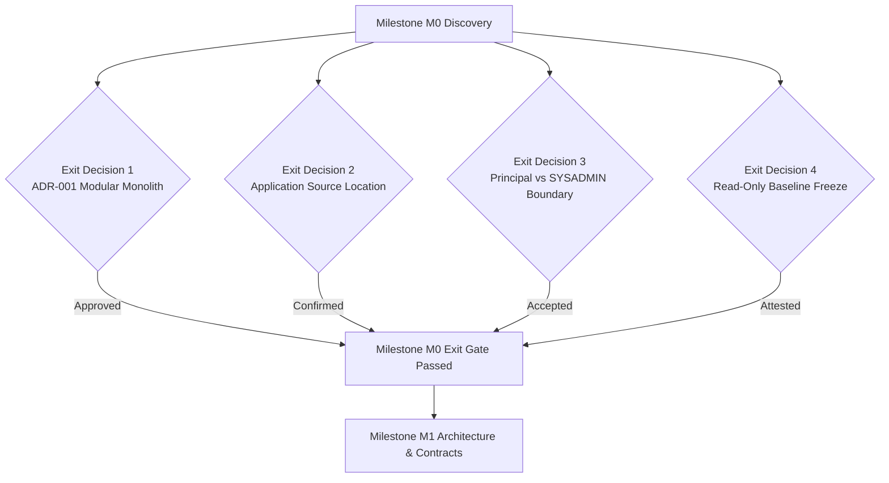

# Consolidated Decision & Risk Register (Milestone M0.5)

**Document Code:** M0.5 — Decision & Risk Register  
**Task Owner:** Shashidhar (Project Lead & Architecture Owner)  
**Reviewer:** Unassigned — solo-owner mode; self-review is not independent peer approval.
**Document Status:** Canonical Register (In Review)  
**Baseline Reference:** Signed BRD v1.4, Signed SRS v1.4, Baseline Commit `5e1c47e`, M0.4 Database Schema Inventory  
**Database Safety Impact:** **Strictly Read-Only** — zero database writes, resets, migrations, or data mutations performed.  

---

## 1. Executive Summary & Purpose

This document serves as the **single canonical Decision & Risk Register** for the School Admission & Fee Management Portal. It consolidates, supersedes, and unifies all previous fragmented trackers (`OPEN_ITEMS.md`, `DECISIONS.md`, and SRS §13) into one authoritative record.

### Core Governance Rules:
1. **Single Source of Truth:** No secondary or conflicting decision register shall be maintained. All pending questions, architectural assumptions, security risks, and delivery boundaries are centralized here.
2. **Fact vs. Proposal Distinction:** Confirmed decisions (signed in BRD v1.4 / SRS v1.4 by Client Rakesh Aralikatti and Project Manager Shashidhar) are strictly partitioned from active proposals and open client dependencies.
3. **No Unapproved Assumptions in Code:** Engineering implementation must not silently hardcode speculative defaults for open business items. Every item requires an explicit owner, recommended pathway, approver, and required-by milestone.
4. **Authority Separation:** Formal business decision and change-control authority resides strictly with the **Client / Principal**, while technical architecture authority resides with the **Project Lead**. The **System Administrator (SYSADMIN)** is strictly an operational operator with zero business policy or financial ledger override authority.

---

## 2. Role-Authority Governance: Principal vs. System Administrator

A critical architectural ambiguity identified in legacy project discussions concerns the division of authority between the **Principal** and the **System Administrator (SYSADMIN)**. This section formally resolves this ambiguity for both operational runtime permissions and formal project change control.

### 2.1 The Ambiguity
In technical cloud platforms (like Supabase, PostgreSQL, and Linux hosts), a "System Administrator" often holds elevated credentials (e.g. database superuser, service-role keys, cloud console access). In some school software setups, this has created confusion where technical staff were assumed to possess the power to override admission decisions, waive student fee arrears, alter ledger transactions, or approve policy changes.

### 2.2 Operational RBAC Boundary Matrix
In accordance with signed SRS §2.2 (`RC-01` vs `RC-04`), BRD §4, and System-Wide Business Rule `R-05`:

| Action / Capability | Principal (Institutional Authority) | System Administrator (Technical Operator) | Architectural Enforcement & Boundary |
|---|:---:|:---:|---|
| **Approve / Reject Admissions** | **Sole Authority** | **Prohibited** | Only `principal` role can update `admission_applications.status` to `approved` or `rejected`. SYSADMIN cannot admit students. |
| **Grant Fee Concessions & Waivers** | **Sole Authority** | **Prohibited** | `fee_adjustments` approvals require `approved_by` to be the Principal. Zero concession authority for SYSADMIN. |
| **Reverse Payments / Order Refunds** | **Sole Authority** | **Prohibited** | Financial ledger reversals require Principal sign-off with recorded justification. SYSADMIN has zero financial write access. |
| **Approve Fee Structures & Tariffs** | **Sole Authority** | **Prohibited** | `fee_structures.approved_by` restricted to Principal. SYSADMIN cannot change annual tuition schedules. |
| **Approve & Sign LC/TC Certificates** | **Sole Authority** | **Prohibited** | `student_year_certificates.approved_by` restricted to Principal. SYSADMIN cannot sign or release student certificates. |
| **Sign Fee Receipts ("Manager")** | **Mandatory** | **Prohibited** | Per BRD §5.7 and D-006, Manager signature represents the Principal. SYSADMIN signature is invalid. |
| **Adjust Section Seat Capacities** | **Authorized** | **Prohibited** | Setting or modifying `sections.max_capacity` is an institutional prerogative reserved for Principal. |
| **Access Sensitive PII (Aadhaar/Income)** | **Authorized** | **Prohibited** | Sensitive demographic and document records are restricted strictly to `ADM` and `PRINCIPAL` (Rule `R-06`). |
| **User Lifecycle & Role Assignment** | Policy Approval Only | **Operational Owner** | SYSADMIN invites/provisions users in `staff_members` and triggers password resets, based on Principal's written mandate. |
| **Infrastructure, Backups & Host Health** | Read-Only Visibility | **Operational Owner** | SYSADMIN monitors hosting runtime, database connection pools, storage buckets, and backup scripts. |
| **Audit Log Deletion / Modification** | **Prohibited** | **Prohibited** | Database triggers (`reject_immutable_update`, `prevent_hard_delete`) block all users, including SYSADMIN, from altering audit logs. |

### 2.3 Formal Project Decision & Change-Control Governance
For software modifications, scope revisions, and baseline approvals:
1. **Business Scope & Commercial Changes:** Can **only** be approved jointly by **Rakesh Aralikatti** (Client Signatory) and **Shashidhar Pawadashetti** (Intallo Project Manager).
2. **Technical Architecture & Migrations:** Can **only** be approved by **Shashidhar** (Project Lead & Architecture Owner) following independent peer review.
3. **SYSADMIN Non-Authority:** The System Administrator role has zero change-control authority. SYSADMIN cannot approve change requests (such as CR-001 or CR-002), alter schema migrations, or unilaterally modify signed acceptance criteria.

---

## 3. Part I: Confirmed Domain & Architectural Invariants

The following 12 architectural decisions have been formally approved in signed BRD v1.4, signed SRS v1.4, or verified project change records. They are closed and serve as immutable constraints:

| ID | Confirmed Rule / Invariant | Business & Architectural Consequence | Source Evidence | Approver & Date |
|---|---|---|---|---|
| **DEC-01** | **No Payment Gate for Admission** | Admission approval must never be blocked by or depend on fee payment. Admission Fee is variable; no mandatory initial payment or fixed installment schedule exists. | BRD §5.3, SRS §3 A-04, A-17, SBR-02 | Rakesh Aralikatti (Client) — 15 Oct 2026 |
| **DEC-02** | **Offline Payment Recording Only** | The application is strictly an offline recording portal. No payment gateway, processor integration, online checkout, or digital wallet API is in scope. | BRD §5.6, SRS §3 A-04, D-003 | Rakesh Aralikatti (Client) — 22 Oct 2026 |
| **DEC-03** | **Shared Monotonic Receipt Sequence** | All receipts (Fees, Books, Vehicle, and Final Consolidated Receipts) draw sequentially from one unified monotonic numbering series (`RCT-YYYY-NNNNNN`). | BRD §5.7, SRS §3 A-10, SBR-07 | Rakesh Aralikatti (Client) — 22 Oct 2026 |
| **DEC-04** | **Final Fees Receipt at Zero Dues Only** | A numbered Final Fees Receipt is issued strictly when net balance is ₹0.00 across all applicable fee heads. Statement of account (unnumbered) is printable anytime. | SRS §3 A-28, US-28, SBR-08 | Rakesh Aralikatti (Client) — 22 Oct 2026 |
| **DEC-05** | **Manager Signature Represents Principal** | All receipts require signature lines for Payer, Cashier, and Manager. The Manager is confirmed to be the Principal; Payer signature is physically hand-signed on printout. | SRS §3 A-29, US-27, D-006 | Rakesh Aralikatti (Client) — 22 Oct 2026 |
| **DEC-06** | **Zero Cross-Year Carry-Forward** | The portal enforces strict annual isolation. Unpaid fee arrears at year-end are never carried forward into the next academic year's ledger; handled offline by school. | BRD §5.4, SRS §3 A-07, SBR-05 | Rakesh Aralikatti (Client) — 15 Oct 2026 |
| **DEC-07** | **Zero Hard Deletes & Immutable Ledger** | No physical row deletion is permitted across 21 core tables. Payments, allocations, receipt snapshots, certificate versions, and audit logs are strictly immutable. | BRD §5.6, SRS §4 R-01, R-02, SBR-04, NFR-09 | Signed BRD/SRS v1.4 — 22 Oct 2026 |
| **DEC-08** | **Annual LC/TC Independent of Left Status** | Leaving / Transfer Certificates are generated annually per student academic record. Generating an LC/TC does not automatically mark a continuing student as Left/Transferred. | BRD §5.9, SRS §3 A-33, SBR-09 | Signed BRD/SRS v1.4 — 14 Oct 2026 |
| **DEC-09** | **Source-Only Delivery Boundary** | Intallo's deliverable is strictly verified source code and handover package. Client owns hosting, server infrastructure, live security, backups, and live operations. | BRD §13, SRS §3 A-19, D-010, D-011 | Signed BRD/SRS v1.4 — 22 Oct 2026 |
| **DEC-10** | **Single Fee Category per Payment** | Every payment belongs to exactly one `fee_category` (`school_fee`, `vehicle`, or `books`). Payment allocations cannot mix heads from different categories. | SRS §4 R-17, BR-17, Migration `20261022090000` | Signed SRS v1.4 — 22 Oct 2026 |
| **DEC-11** | **Exact Decimal Currency Representation** | All currency amounts are represented in exact INR decimals (`numeric(10,2)`); floating-point math is strictly prohibited across database and application logic. | SRS §4 R-10, NFR-05, SBR-03 | Signed SRS v1.4 — 22 Oct 2026 |
| **DEC-12** | **One Primary Guardian Contact** | A student may have multiple guardian records in `student_guardians`, but exactly one guardian must be designated as `is_primary_contact = true`. | Schema `student_guardians_one_primary_idx` | Schema Baseline `5e1c47e` |

---

## 4. Part II: Consolidated Decision & Risk Register (20 Material Items)

The table below enumerates all known open business decisions, technical dependencies, security risks, and delivery assumptions.

| ID | Title & Category | Status | Affected Scope | Req Milestone | Owner & Approver | Core Ambiguity / Risk | Recommended Pathway | Next Action & Target Evidence |
|---|---|:---:|:---:|:---:|---|---|---|---|
| **REG-01** | **Principal vs. SYSADMIN Authority Boundary** `Security / Governance` | **Proposed — Gating M0 Exit** | `identity-access`, M3.1, M3.2 | **M0 Exit / M3.1** | **Owner:** Shashidhar **Approver:** Client / Principal | Ambiguity over technical SYSADMIN vs. institutional Principal authority. | Enforce zero financial, admission, and student data override rights for SYSADMIN. SYSADMIN restricted to account provisioning and system health. | Adopt §2 Governance Matrix in M3.1 Role Spec; self-checked by Shashidhar with automated tests (no independent peer review). |
| **REG-02** | **100-Seat Capacity Scope & Enforcement** `Unresolved Business Rule` | **Open — Escalated** | `admissions`, US-42, BR-38 | **M4.2** | **Owner:** Shashidhar **Approver:** Client / Principal | SRS §3 A-08 notes 100 seats per section (Pre-primary, Primary, High School). Unclear if cap is per section, per grade, or across group. | Configure capacity on `sections.max_capacity` (default 40 per class) with group-level cap in school settings; block approval in app layer. | Obtain Client written confirmation on capacity granularity before M4.2 implementation. |
| **REG-03** | **LC/TC Issuance with Unpaid Dues** `Unresolved Business Rule` | **Working Assumption** | `certificates-lctc`, US-31, US-35 | **M6.3** | **Owner:** Shashidhar **Approver:** Client / Principal | SRS §3 A-13: Can a Transfer Certificate be issued if student has outstanding fee dues? | Permitted with explicit Principal override and mandatory recorded justification; flag unpaid balance on review screen. | Submit approval dialog UX to Principal; confirm whether hard-block or override is required. |
| **REG-04** | **Admission Fee Refund & Reversal Policy** `Unresolved Business Rule` | **Working Assumption** | `fees-ledger`, US-26A, BR-22 | **M5.4** | **Owner:** Shashidhar **Approver:** Client / Principal | SRS §3 A-06, BRD §16.2: Is Admission Fee strictly non-refundable, or can Principal approve refunds? | Treat Admission Fee as refundable only via Principal-approved reversal adjustment; zero physical deletion. | Draft financial reversal policy; confirm refund authority with Principal in M5.4. |
| **REG-05** | **Administrative Authority for Fee Setup** `Unresolved Business Rule` | **Working Assumption** | `fee-configuration`, US-17, US-18 | **M5.1** | **Owner:** Shashidhar **Approver:** Client / Principal | SRS §3 A-23: Who is the "Admin" that configures fee heads, places, and amounts? | Two-person rule: Accounts Officer (`ACC`) drafts fee heads/tariffs; Principal formally approves before release. | Encode workflow in M5.1 API contract: `created_by` (ACC) and `approved_by` (Principal). |
| **REG-06** | **Vehicle Transportation Tariff Model** `Unresolved Business Rule` | **Working Assumption** | `fee-configuration`, US-19, BR-15 | **M5.1** | **Owner:** Shashidhar **Approver:** Client / Principal | SRS §3 A-27: Is vehicle fee priced purely by destination Place, or Place + Grade Standard? | Pricing primarily by geographic Place with optional standard override supported by `transport_rates`. | Validate current school bus routes and fee amounts with school transport coordinator. |
| **REG-07** | **Books & Uniform Compulsory Status** `Unresolved Business Rule` | **Working Assumption** | `fee-configuration`, US-18, US-20 | **M5.1** | **Owner:** Shashidhar **Approver:** Client / Principal | SRS §3 A-30: Are books and uniform mandatory for all students of a standard, or optional? | Model as mandatory fee head per standard, billed annually; optional items handled via separate heads. | Verify book kit pricing per grade level with school office before seeding M5.1. |
| **REG-08** | **Complete Catalog of Receipt Types** `Delivery Assumption` | **Confirmed Core; Open Other** | `fee-configuration`, `receipts`, US-17 | **M5.1** | **Owner:** Shashidhar **Approver:** Client / Principal | SRS §3 A-22: Fees, Books, and Vehicle confirmed. Are there any other receipt types? | Lock core enums to `school_fee`, `vehicle`, `books`; design extensible schema for future categories. | Client to confirm if sports, laboratory, or exam fees require distinct receipt categories. |
| **REG-09** | **Admission Number Uniqueness Scope** `Technical Dependency` | **Working Assumption** | `admissions`, `students`, SBR-01 | **M4.4** | **Owner:** Shashidhar **Approver:** Client / Principal | DB has global unique constraint on `admission_number`. Is it permanent across school or annual? | Permanent institutional lifetime admission number (`ADM-YYYY-NNNN`), unique across all years. | Confirm numbering scheme with school admissions office before generating M4.4 logic. |
| **REG-10** | **Seat Release for Non-Joining Students** `Unresolved Business Rule` | **Working Assumption** | `admissions`, US-32, US-42 | **M4.2** | **Owner:** Shashidhar **Approver:** Client / Principal | SRS §3 A-18: How is a reserved seat freed if an approved student never pays or attends? | Admission Officer marks application `withdrawn` or academic record `withdrawn`, automatically freeing seat. | Document state transition: `approved` → `withdrawn` releases capacity reservation. |
| **REG-11** | **Sensitive PII Collection & Access Scope** `Security & Privacy (DPDP)` | **Working Assumption** | `students`, US-08, US-09, R-06 | **M4.1 / M4.5** | **Owner:** Shashidhar **Approver:** Client / Principal | Privacy protection for Aadhaar, caste, sub-caste, and annual family income under DPDP Act. | Keep `student_sensitive_details` in 1:1 table; store last 4 digits of Aadhaar only; restrict to ADM/Principal. | Implement field-level masking and zero logging of sensitive PII in M4.5 security audit. |
| **REG-12** | **Minimum Age Verification per Standard** `Unresolved Business Rule` | **Open — Advisory** | `admissions`, US-08, A-09 | **M4.1** | **Owner:** Shashidhar **Approver:** Client / Principal | School has not provided official minimum age cutoff per class. | Calculate age from DOB dynamically; display advisory info; keep blocking validation disabled until rules supplied. | Present standard age guidelines (e.g. Nursery = 3 yrs) to Principal for approval. |
| **REG-13** | **Final Application Status State Machine** `Unresolved Business Rule` | **Proposed Alignment** | `admissions`, Status Model | **M4.2** | **Owner:** Shashidhar **Approver:** Shashidhar | Alignment between SRS working states and DB `admission_application_status` enum. | Adopt 7 DB enum states: `draft`, `submitted`, `under_review`, `on_hold`, `approved`, `rejected`, `withdrawn`. | Formalize allowed state transitions in M4.2 workflow specification. |
| **REG-14** | **Official Government-Approved LC/TC Layout** `Delivery Assumption` | **Open — Asset Required** | `certificates-lctc`, US-36, A-14 | **M6.3** | **Owner:** Shashidhar **Approver:** Client / Principal | Exact Karnataka state education department format, required serial numbers, and seal requirements. | Draft standard bilingual (Kannada/English) layout with watermark for duplicate reissues. | Client to supply scanned physical copy of approved school LC/TC form. |
| **REG-15** | **High-Resolution Letterhead & Print Sizes** `Delivery Assumption` | **Open — Asset Required** | `receipts`, `certificates`, US-27 | **M6.2 / M6.4** | **Owner:** Shashidhar **Approver:** Client / Principal | SRS §3 A-15: Mock-ups approved, but high-res letterhead and print dimensions (A4 vs A5) missing. | Support both A4 and A5 landscape receipts; implement PDF rendering engine with configurable header/footer. | Request vector/PNG letterhead file and physical print dimensions from Client. |
| **REG-16** | **Mandatory Document Checklist per Standard** `Unresolved Business Rule` | **Working Assumption** | `documents`, US-10, US-11 | **M4.3** | **Owner:** Shashidhar **Approver:** Client / Principal | Specific required documents vary by age/grade (Nursery birth cert vs Std 8 transfer certificate). | Base defaults on `document_requirements` table (Birth Certificate & Photo mandatory; TC conditional). | School clerk to verify checklist per standard prior to M4.3 implementation. |
| **REG-17** | **Initial Admin Provisioning & Password Reset** `Security & Technical Dependency` | **Proposed — Gating M0 Exit** | `identity-access`, US-03, RC-04 | **M0 Exit / M3.2** | **Owner:** Shashidhar **Approver:** Shashidhar | Seeded staff members have `auth_user_id IS NULL`. First login password reset procedure required. | Provide secure server-side CLI bootstrap script creating initial admin; enforce password change on first login. | Script design reviewed in M0.3; implement execution command in M3.2 without hardcoded secrets. |
| **REG-18** | **Audit Trail & Document Retention Period** `Compliance Dependency` | **Working Assumption** | `audit_logs`, `documents`, NFR-09 | **M3.5** | **Owner:** Shashidhar **Approver:** Client / Principal | Statutory retention duration for financial audit logs, student documents, and fee snapshots. | Retain all records indefinitely in DB; establish 7-year statutory financial archive policy for handover runbook. | Include retention recommendation in M8.1 operations runbook. |
| **REG-19** | **Application Source Tree & Package Layout** `Technical Dependency` | **Proposed — Gating M0 Exit** | `architecture`, M1.1, M2.1 | **M0 Exit / M1.1** | **Owner:** Shashidhar **Approver:** Team Review | Repository root contains database migrations, types, and docs, but no visible frontend/backend source tree. | Confirm target framework (Next.js / Node.js modular monolith) in M1.1 ADR before creating scaffold. | Shashidhar to submit ADR-001 with verified application package manifest and module layout. |
| **REG-20** | **Row-Level Security vs. Server-Side Mediation** `Security Architecture` | **Proposed — Gating M0 Exit** | `architecture`, `security`, M1.1, M3.2 | **M0 Exit / M1.1** | **Owner:** Shashidhar **Approver:** Shashidhar | DB has fail-closed RLS with 0 client policies. Should portal use server-side mediation or client RLS? | Adopt server-side mediation via `service_role` (modular monolith API boundary) as primary security model. | Document in ADR-001; evaluate optional client RLS policies for defense-in-depth in M3.2. |

---

## 5. Part III: Gating Decisions Required to Exit Milestone M0

Milestone **M0 (Project Baseline & Planning)** cannot be formally closed, and Milestone **M1 (Architecture & Contracts)** cannot commence, until the following **4 critical decisions** are resolved and signed off:

### Detailed Exit Gates:
1. **Exit Gate 1: Architecture Pattern Acceptance (REG-19, REG-20):**
   - **Decision Required:** Formal acceptance of ADR-001 adopting a modular monolith with trusted server-side API mediation over direct browser database access.
   - **Owner:** Shashidhar (Architecture Owner).
   - **Target Milestone:** M1.1.
2. **Exit Gate 2: Source Tree & Package Manifest Confirmation (REG-19):**
   - **Decision Required:** Confirmation of the application source directory and package management layout (Node.js/Next.js/TypeScript) so that downstream implementation teams do not guess folder boundaries.
   - **Owner:** Shashidhar (Project Lead).
   - **Target Milestone:** M1.1 / M2.1.
3. **Exit Gate 3: Principal vs. System Administrator Governance Invariant (REG-01):**
   - **Decision Required:** Formal adoption of Section 2 governance matrix establishing that the Principal retains exclusive business, financial, and student decision authority, and that SYSADMIN is strictly a technical operator with zero override capability.
   - **Owner:** Shashidhar (Lead) & Ujwal (Admissions Owner).
   - **Target Milestone:** M0 Exit / M3.1.
4. **Exit Gate 4: Read-Only Baseline Freeze Attestation:**
   - **Decision Required:** Formal re-attestation that repository baseline commit `5e1c47e` and retained database `fjrfyzamiirqzitdchkz` remain 100% pristine with zero unauthorized schema mutations or test resets.
   - **Owner:** All Team Members (Shashidhar, Ujwal, Sujal, Jeevan).
   - **Target Milestone:** M0 Exit.

---

## 6. Part IV: Read-Only Safety Attestation & Review

- **Inspection Date:** 2026-10-27  
- **Safety Attestation:** All risks, open items, and decisions documented in this register were derived from non-destructive inspection of signed project requirements, repository documentation, and static schema definitions. Zero writes, resets, or data modifications were executed against the retained database.  
- **Deliverable Sign-Off:**  
  - **Authored & Submitted by:** Shashidhar Pawadashetti (Project Lead & Architecture Owner)  
  - **Submitted for Independent Review to:** Ujwal (Admissions & Student Records Owner)
