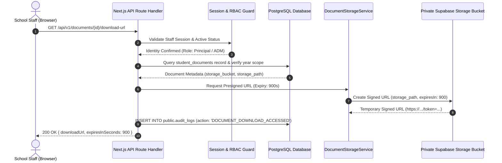

# Private Document Storage & PDF Generation Design

**Document Code:** PRIV-DOC-PDF-001  
**Version:** 1.0 (Phase 1 Deliverable)  
**Baseline References:** Signed BRD v1.4, Signed SRS v1.4, ADR-001, ARCHITECTURE.md  
**Implementation Owner:** Senior Software Engineer  

---

## 1. Executive Summary & Core Objectives

This technical design document establishes the architecture for:
1. **Private Document Storage:** Securing student admission attachments and generated official documents in private Supabase Storage buckets with server-signed, short-lived URLs.
2. **Server-Side PDF Generation:** Rendering tamper-evident, print-ready A4/A5 documents (Fee Receipts, Final Fees Receipts, Statements of Account, and Transfer Certificates) using `@react-pdf/renderer` matching the verified school paper forms.
3. **Immutability & Reprint Governance:** Storing immutable JSON rendered snapshots in PostgreSQL, tracking reprint counts, applying prominent "DUPLICATE COPY" watermarks, and auditing every access event.

---

## 2. Private Document Storage Architecture

### 2.1 Storage Buckets Configuration
Three isolated Supabase Storage buckets are provisioned with **public access strictly disabled**:

| Bucket Name | Target Documents | MIME Types Permitted | Max File Size | Access Control Policy |
|---|---|---|:---:|---|
| `admission-documents` | Student birth certificate, photograph, previous marksheets, parent ID | `image/jpeg`, `image/png`, `application/pdf` | 10 MiB | Authenticated staff (`principal`, `admission_officer`, `clerk`). |
| `receipts` | Server-rendered PDF fee receipts and consolidated final receipts | `application/pdf` | 5 MiB | Authenticated staff (`principal`, `accountant`). |
| `certificates` | Server-rendered PDF Leaving and Transfer Certificates | `application/pdf` | 5 MiB | Authenticated staff (`principal`, `admission_officer`). |

### 2.2 Storage Security & Presigned URL Lifecycle



#### Security Guardrails:
1. **Zero Public Access:** Storage bucket `public = false`. Direct unauthenticated CDN links return `403 Access Denied`.
2. **15-Minute Expiry (900s):** Signed URLs expire after exactly 900 seconds. URLs cannot be cached or shared permanently.
3. **Download Audit:** Every download URL generation inserts an immutable row into `public.audit_logs` capturing `actor_staff_id`, `document_id`, `student_id`, and `timestamp`.

---

## 3. Server-Side PDF Generation Architecture

### 3.1 Technology Stack & Rendering Engine
- **Engine:** `@react-pdf/renderer` (React primitives `Document`, `Page`, `View`, `Text`, `Image`, `StyleSheet` executed in Node.js server environment).
- **Font Embedding:** Open-source TrueType fonts (`Roboto` / `Inter`) embedded directly into the binary bundle to ensure 100% deterministic, pixel-perfect layout across Linux, Windows, and macOS host servers.
- **Color Space:** CMYK-safe RGB palette optimized for monochrome and color laser office printers.
- **Page Dimensions:**
  - Receipts: **A5 Landscape** (`210mm × 148mm`) or **A4 Portrait** with dual-voucher split (School Copy & Parent Copy).
  - Leaving / Transfer Certificate: **A4 Portrait** (`210mm × 297mm`).

---

## 4. Document Templates & Visual Standards

### 4.1 Payment Receipt Template (SRS US-27, BR-24, BR-26)
Matches the physical ABC English Medium School receipt layout:

1. **Header Block:**
   - School Name: **ABC ENGLISH MEDIUM SCHOOL**
   - Address, Recognition/Affiliation Number, DISE Code.
   - Receipt Title: `FEES RECEIPT` / `BOOKS RECEIPT` / `VEHICLE RECEIPT`.
2. **Metadata Grid:**
   - Receipt Number: `RCT-YYYY-NNNNNN` (**6 digits zero-padded**).
   - Date: `DD/MM/YYYY`.
   - Academic Year: `2026-2027`.
3. **Student Profile:**
   - Admission Number: `ADM-YYYY-NNNN`.
   - Student Name: Full student name.
   - Standard & Section: e.g. `STD 5 - A`.
   - Payer Name: Full name of parent/payer.
4. **Itemized Allocation Table:**
   - Columns: Sl No, Fee Head Description, Category, Amount (₹).
   - Row lines for each allocated head.
   - Total Amount in Figures: `₹ XX,XXX.00`.
   - **Total Amount in Words:** Indian English numbering system (`Rupees ... Only`).
5. **Physical Signature Block (Non-Negotiable):**
   - Three distinct signature lines:
     - `Payer's Signature` (Physically hand-signed on printed voucher).
     - `Cashier's Signature` (Cashier/Accountant hand signature).
     - `Manager's Signature` (Confirmed to represent the **Principal**).

---

### 4.2 Final Fees Receipt Template (SRS US-28, BR-25, BR-47)
Issued strictly when net dues across all heads equal ₹0.00:

1. **Header Block:** Explicit title: `FINAL CONSOLIDATED FEES RECEIPT (FULL PAYMENT SETTLEMENT)`.
2. **Clearance Statement:** Prominent clearance declaration: *"This certifies that all prescribed fees for the academic year 2026-2027 have been fully paid. Total Outstanding Dues: ₹0.00."*
3. **Prior Receipts Summary Table:**
   - Itemized list of all prior payment receipts: Receipt No, Payment Date, Fee Category, Amount Paid (₹).
4. **Grand Total Settled:** Total annual fees collected.
5. **Signatories:** Identical three signature lines (Payer, Cashier, Manager/Principal) plus official School Stamp area.

---

### 4.3 Leaving / Transfer Certificate (LC/TC) Template (SRS US-36, BR-34)
Formatted to the Karnataka State Education Department standard:

1. **Header:** `ABC ENGLISH MEDIUM SCHOOL — TRANSFER / LEAVING CERTIFICATE`.
2. **Sequential Certificate Number:** `TC-YYYY-NNNN` (e.g. `TC-2026-0001`).
3. **Student Information Fields:**
   - Student Full Name, Father's Name, Mother's Name.
   - Nationality, Religion, Caste Category.
   - Date of Birth (in figures and words).
   - STS Number, DISE Number.
   - Standard Enrolled, Date of Admission, Standard Leaving.
   - Reason for Leaving, Conduct & Character, Attendance Record.
4. **Official Closure:**
   - Date of Issue, Signature of Admission Clerk, Signature of Principal with Institutional Seal.

---

### 4.4 Unnumbered Statement of Account (SRS US-28, BR-46)
- Available at any time regardless of whether dues are outstanding.
- Displays full fee breakdown (Billed, Concessions, Paid, Balance).
- **Prominent Watermark / Notice:** Header explicitly states: *"STATEMENT OF ACCOUNT — THIS IS NOT AN OFFICIAL RECEIPT"*. Lacks receipt number and formal clearance stamp.

---

## 5. Duplicate Handling & Reprint Governance (SRS US-29, US-37)

1. **Initial Issue:** First PDF generation has `reprint_count = 0`. No duplicate mark is applied.
2. **Reprint Workflow:**
   - Request to reprint invokes `POST /api/v1/receipts/{id}/reprint` or `/api/v1/certificates/{id}/reprint`.
   - Server validates caller role (`principal` or `accountant`).
   - Server executes atomic increment: `reprint_count = reprint_count + 1`, `last_reprinted_at = clock_timestamp()`.
   - Server logs audit event: `RECEIPT_REPRINTED` with caller ID and recorded reason.
3. **Watermark Specification:**
   - A semi-transparent red diagonal watermark text: **"DUPLICATE COPY (REPRINT #N)"** rendered across the background at 45 degrees (`opacity: 0.18`, font size: 48pt).
   - Timestamp and reprint reason printed in small font at the footer: *"Reprinted on DD/MM/YYYY HH:MM by [Staff Name]. Reason: [Reason]"*.

---

## 6. Currency In Words Algorithm (Indian Numbering System)

To satisfy BR-26, amounts must be converted into words using the Indian numbering system (`crores`, `lakhs`, `thousands`, `hundreds`):

```typescript
export function formatInrToWords(amountInr: string | number): string {
  // Exact integer paise parsing
  const numericVal = typeof amountInr === 'string' ? parseFloat(amountInr) : amountInr;
  const integerPart = Math.floor(numericVal);
  const paisePart = Math.round((numericVal - integerPart) * 100);

  const units = ['', 'One', 'Two', 'Three', 'Four', 'Five', 'Six', 'Seven', 'Eight', 'Nine', 'Ten',
    'Eleven', 'Twelve', 'Thirteen', 'Fourteen', 'Fifteen', 'Sixteen', 'Seventeen', 'Eighteen', 'Nineteen'];
  const tens = ['', '', 'Twenty', 'Thirty', 'Forty', 'Fifty', 'Sixty', 'Seventy', 'Eighty', 'Ninety'];

  function convertTwoDigits(n: number): string {
    if (n < 20) return units[n];
    return tens[Math.floor(n / 10)] + (n % 10 !== 0 ? ' ' + units[n % 10] : '');
  }

  function convertHundreds(n: number): string {
    let str = '';
    if (Math.floor(n / 100) > 0) {
      str += units[Math.floor(n / 100)] + ' Hundred ';
      n %= 100;
    }
    if (n > 0) {
      str += convertTwoDigits(n);
    }
    return str.trim();
  }

  let crore = Math.floor(integerPart / 10000000);
  let rem = integerPart % 10000000;
  let lakh = Math.floor(rem / 100000);
  rem %= 100000;
  let thousand = Math.floor(rem / 1000);
  rem %= 1000;
  let hundred = rem;

  let words = '';
  if (crore > 0) words += convertHundreds(crore) + ' Crore ';
  if (lakh > 0) words += convertHundreds(lakh) + ' Lakh ';
  if (thousand > 0) words += convertHundreds(thousand) + ' Thousand ';
  if (hundred > 0) words += convertHundreds(hundred);

  words = words.trim() || 'Zero';
  let result = `Rupees ${words} Only`;
  if (paisePart > 0) {
    result = `Rupees ${words} and ${convertTwoDigits(paisePart)} Paise Only`;
  }
  return result;
}
```
