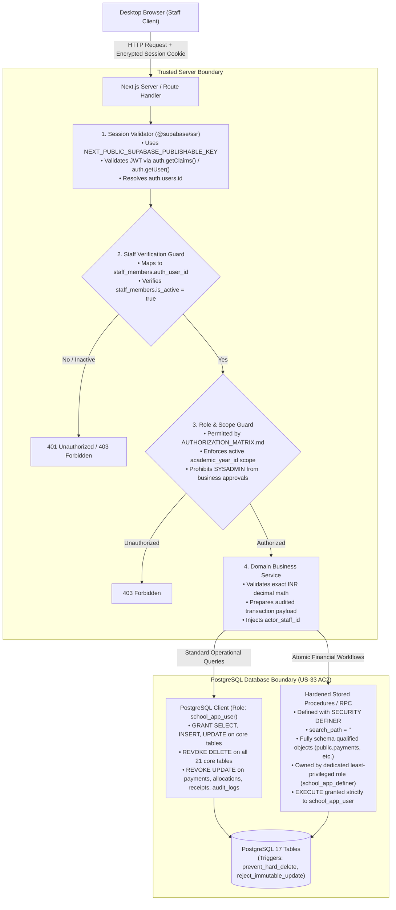

# ADR-001: Architecture Decision Record — Modular Monolith Framework & Security Design

- **Status:** Proposed / Formally Reviewed for Phase 1 Lock
- **Date Created:** 2026-10-26
- **Date Revised:** 2026-10-29 (Phase 1 Architecture Lock, US-33 AC2 Resolution & Atomic Contracts)
- **Document Code:** M1.1 — Architecture Decision Record
- **Task Owner:** Senior Software Engineer (Implementation Owner)
- **Approvers Required:** 
  - Technical Architecture: Shashidhar Pawadashetti (Project Lead & Architecture Owner)
  - Business & Operational Governance: Rakesh Aralikatti (Client Signatory / Principal)
- **Authoritative Baselines:** Signed BRD v1.4, Signed SRS v1.4 (Approved 22 Oct 2026), Baseline Commit `5e1c47e`, and Phase 1 Database Audit (`docs/CTO_DATABASE_AUDIT.md`)

---

## 1. Context & Verified Repository Baseline

### 1.1 Verified Repository Identity & Baseline State
The Phase 1 repository audit established the following facts:
- **Active Task Branch:** `task-phase1-architecture-audit-contracts` (branched from canonical `main` at `32c51bf`).
- **Protected Foundation Baseline:** Commit `5e1c47e0d85d5dbe54d84b1f3d31b87622e2f3ca` (initial database schema and synthetic demo baseline). This commit represents the foundational database contract and must be preserved without destructive reset or overwrite.
- **Retained Remote Database Reference:** `fjrfyzamiirqzitdchkz`. **Strictly Protected** — zero development migrations, resets, or mutations are permitted against this remote instance. All development and testing execute against disposable local PostgreSQL instances.
- **Canonical Remote Repository:** `https://github.com/Intallo/Admission-Fee-Management-Portal.git`.
- **Observed Source-Tree Status:** The repository contains complete specifications, database migrations, synthetic demo seed (`supabase/seed.sql`), and generated TypeScript schema types (`src/types/database.types.ts`). Application manifests (`package.json`), build configurations, and UI/API code are pending Phase 2 scaffolding.

### 1.2 Handover and Operational Context
Under signed BRD §2.1 and SRS §1.3:
- **Intallo Deliverable:** Strictly verified **project source code and a handover package** (no hosting, cloud operations, or live database administration).
- **Client Ownership:** The Client (Rakesh Aralikatti) and ABC English Medium School operate, host, secure, back up, and maintain the production environment.
- **Operational Boundary:** The application runtime must remain minimal, robust, easily containerized, and deployable on a single virtual host without complex distributed microservice infrastructure.

---

## 2. Evaluation of Architecture Options

Two primary architecture candidates were evaluated against project constraints:

| Evaluation Dimension | Option A: Next.js + TypeScript Modular Monolith (Selected) | Option B: React (Vite) SPA + Node.js (Express) Separate Backend |
|---|---|---|
| **Deployment Complexity** | **Low.** Single unified application package, single runtime process (`node server.js` or standalone Next.js Docker container), single HTTP port. Ideal for Client source-only handover. | **Medium-High.** Two separate codebases/directories, two runtimes, two build pipelines, requiring reverse-proxy configuration (NGINX/Caddy) to avoid cross-domain complexities. |
| **Module Boundaries** | **High.** Feature modules (`src/modules/*`) encapsulate UI pages, domain services, data access adapters, and validation schemas behind clean TypeScript interfaces. | **High.** Physical separation between frontend components and backend Express routers, but requires duplicate domain interfaces or shared monorepo packages. |
| **Type Sharing & Safety** | **Seamless.** Frontend and backend run in a single TypeScript project referencing `src/types/database.types.ts` without monorepo linkers or build steps. | **Moderate.** Requires npm workspace, Turborepo, or symlinking to share database types and DTO definitions between client and server. |
| **Authentication & Session** | **Robust.** Server-side authentication using `@supabase/ssr` with encrypted, HTTP-only cookie sessions. Zero browser token persistence vulnerabilities. | **Moderate.** Requires manual cookie-parsing middleware, JWT verification handlers, CSRF tokens, and refresh token rotation logic in Express. |
| **API & CORS Surface** | **Zero CORS overhead.** UI and API routes share the exact same origin; zero pre-flight latency or cross-origin security misconfigurations. | **CORS Configuration Required.** Must maintain explicit allowed origins, pre-flight handling, and credentials flags across environments. |
| **Private Document Handling** | **High Security.** API Route handlers authenticate staff session, verify student/record scope, and stream file or generate short-lived signed URLs. | **High Security.** Express middleware authenticates session and issues presigned Supabase Storage URLs. |
| **Server-Side PDF Generation** | **Unified.** Generates server-side A4/A5 PDFs via `@react-pdf/renderer` directly within Route Handlers, streaming buffers to client. | **Unified.** Express endpoints render PDF buffers and stream to client. |
| **Testing Harness** | **Unified Harness.** Single Vitest / Playwright harness covering unit domain logic, API integration routes, and end-to-end browser workflows. | **Fragmented.** Separate test harnesses for Vite (Vitest/Jest) and Express (Supertest/Mocha), plus distinct CI runner jobs. |
| **Maintainability for School IT** | **High.** Single repository, single `package.json`, single command startup (`npm run build && npm start`), deterministic environment variables. | **Lower.** Multi-process monitoring, multiple dependency graphs, and higher likelihood of version drift between API and client. |

### 2.1 Formal Recommendation
**Option A (Next.js + TypeScript Modular Monolith)** is formally recommended. It fulfills every requirement of signed BRD v1.4 and SRS v1.4 while minimizing operational moving parts for the Client's post-handover team.

---

## 3. Database Access Architecture & US-33 AC2 Resolution

### 3.1 The Access Architecture Dilemma & US-33 AC2 Requirement
Signed SRS §5 Module 8 (US-33 AC2) states:
> *"The database scripts create an application database user that has no DELETE permission on core tables and no UPDATE permission on the payment ledger, receipts, and audit log, and the setup guide tells the deployer to use it."*

The repository audit (`docs/CTO_DATABASE_AUDIT.md`) established that:
1. All 31 tables are fail-closed with RLS enabled, but currently have **zero policies**.
2. All privileges are currently granted strictly to `service_role`.
3. Relying entirely on `service_role` fails US-33 AC2 because `service_role` is a super-privileged key that bypasses RLS and possesses blanket SQL permissions.
4. Exposing `service_role` to the browser is strictly prohibited.

### 3.2 Evaluated Database Access Models

| Model | Description | Pros | Cons | Verdict |
|---|---|---|---|---|
| **Model 1: Direct Client RLS (BaaS Style)** | Browser connects directly to Supabase using `anon`/`authenticated` tokens with 31+ complex RLS policies. | Native Supabase pattern; offloads API routes. | Exposes DB schema to browser; difficult to enforce multi-table atomic financial operations; no support for US-33 AC2 DB user; leaks complexity to client. | **REJECTED** |
| **Model 2: Server-Only `service_role`** | Server-mediated monolith where all domain services use `service_role` client. | Simple single client; bypasses RLS hurdles. | Completely fails US-33 AC2; lacks defense-in-depth; accidental code bug could delete or mutate ledger. | **REJECTED as Sole Boundary** |
| **Model 3: Server-Mediated Dual Security with Restricted Application DB Role (Recommended)** | 1. Browser uses `@supabase/ssr` (publishable key, HTTP-only cookie) to validate session and extract actor identity. 2. Server authorizes role and scope. 3. Server queries DB via a **dedicated restricted application role** (`school_app_user`) that has **NO DELETE** and **NO UPDATE on ledger**. 4. Complex atomic transactions execute via hardened `SECURITY DEFINER` stored procedures. | Strictly satisfies US-33 AC2; true defense-in-depth; zero privileged credentials exposed; exact atomicity; verified via SQL negative tests. | Requires authoring dedicated role migration and stored procedures in Phase 2. | **APPROVED & RECOMMENDED** |

### 3.3 The Approved Three-Tier Security Architecture

### 3.4 Hardened Stored Procedure Security Rules
Where `SECURITY DEFINER` is used for atomic business operations:
1. **Empty Search Path:** Every procedure must specify `SET search_path = ''` to prevent search_path hijacking.
2. **Fully Schema-Qualified Objects:** All table references must be explicitly qualified (e.g., `public.payments`, `public.payment_allocations`, `public.receipts`, `public.audit_logs`).
3. **Dedicated Definer Owner:** Owned by `school_app_definer` (a `NOLOGIN` role holding minimum necessary schema mutation rights), never `postgres` superuser.
4. **Execution Permissions:** `REVOKE ALL ON FUNCTION ... FROM PUBLIC, anon, authenticated;` and `GRANT EXECUTE ON FUNCTION ... TO school_app_user;`.
5. **Caller Validation:** The procedure must validate that the provided `actor_staff_id` exists, is active, and possesses the requisite role.

---

## 4. Inviolable Business Invariants & State Transitions

1. **Admission Without Mandatory Payment (DEC-01 / BR-37):** Admission status approval (`admission_applications.status = 'approved'`) must never require payment. The Admission Fee is variable; no minimum payment gate or forced installment plan is permitted.
2. **Offline Payment Recording Only (DEC-02 / BR-17):** The application is strictly an offline collection recorder. No online payment gateways, wallets, or processor SDKs are in scope.
3. **Monotonic Identifiers & Formatting:**
   - **Application Number:** `{sequence}/{academic_year_label}` (e.g. `161/2026-27`).
   - **Admission Number:** `ADM-YYYY-NNNN` (e.g. `ADM-2026-0001`).
   - **Receipt Number:** `RCT-YYYY-NNNNNN` (**6 digits zero-padded**, e.g. `RCT-2026-000001`). Unified series across School Fee, Books, Vehicle, and Final Receipts.
   - **Transfer Certificate Number:** `TC-YYYY-NNNN` (e.g. `TC-2026-0001`).
4. **Final Fees Receipt at Zero Dues Only (DEC-04 / BR-25):** A numbered Final Fees Receipt is issued strictly when the net balance across all applicable fee heads is ₹0.00. An unnumbered Statement of Account is viewable/printable at any time.
5. **Manager Signature Represents Principal (DEC-05 / BR-26):** Receipt templates require signature lines for Payer, Cashier, and Manager. The Manager is confirmed to be the Principal; Payer signs physically upon printout.
6. **Zero Cross-Year Carry-Forward (DEC-06 / BR-39):** Unpaid balances at academic year-end are never automatically carried forward into the subsequent year's ledger.
7. **Zero Hard Deletes & Immutable Ledger (DEC-07 / BR-18, BR-30):** Enforced via `private.prevent_hard_delete()` and role privileges. Financial corrections use approved reversal transactions.
8. **Annual LC/TC Independent of Left Status (DEC-08 / BR-36):** LC/TC records are generated annually per student academic record. Generating an LC/TC does not mark a continuing student as "Left" or "Transferred".
9. **Single Fee Category per Payment (DEC-10 / BR-17):** Every payment belongs to exactly one `fee_category` (`school_fee`, `vehicle`, `books`). Allocations cannot cross categories within a single payment.
10. **Exact Decimal Monetary Arithmetic (DEC-11 / NFR-05):** All currency calculations use exact decimal INR arithmetic (`numeric(10,2)` in DB; integer paise or `decimal.js` in Node.js). Floating-point math is strictly prohibited.

---

## 5. Specification of the Eight Required Atomic Business Operations

| # | Operation Name | Triggering Endpoint | Transactional Scope & Guarantees | Failure & Rollback Behavior |
|---|---|---|---|---|
| **1** | `admit_student_atomic` | `POST /api/admissions/applications/{id}/approve` | 1. Row-lock section and verify `enrolled_count < max_capacity`. 2. Update `admission_applications.status = 'approved'`, record `approved_by`, `approved_at`. 3. Fetch next monotonic admission number (`ADM-YYYY-NNNN`). 4. Create/update `public.students`. 5. Insert `public.student_academic_records`. 6. Create initial `student_fee_assessments` and lines from approved fee structure. 7. Insert `public.audit_logs`. | If section capacity is reached, or fee structure missing, rolls back completely. Zero partial admission. |
| **2** | `record_payment_and_issue_receipt` | `POST /api/fees/payments` | 1. Verify student academic record is active and matches academic year. 2. Verify single `fee_category` across all allocation lines. 3. Row-lock assessment lines; assert `sum(allocations) == payment.amount` and `allocation <= remaining_payable_balance`. 4. Insert `public.payments`. 5. Insert `public.payment_allocations`. 6. Fetch next sequential receipt number (`RCT-YYYY-NNNNNN`) from `receipt_number_counters`. 7. Insert `public.receipts` with immutable `rendered_snapshot` JSONB. 8. Insert `public.audit_logs`. | Any allocation mismatch, overpay on fixed head, or numbering contention rolls back entire payment. |
| **3** | `approve_fee_concession_atomic` | `POST /api/fees/adjustments/{id}/approve` | 1. Verify caller has `principal` role. 2. Row-lock `fee_adjustments` and assessment line. 3. Assert `concession_amount <= remaining_net_payable`. 4. Update `status = 'approved'`, `approved_by`, `approved_at`. 5. Insert `public.audit_logs`. | If concession exceeds balance or non-Principal actor, aborts transaction. |
| **4** | `reverse_payment_atomic` | `POST /api/fees/payments/{id}/reversal` | 1. Verify caller has `principal` role. 2. Row-lock original collection payment; assert not already reversed. 3. Insert reversal payment (`transaction_type = 'reversal'`, `reverses_payment_id = original.id`). 4. Insert offsetting negative `payment_allocations`. 5. Re-open assessment line balances. 6. Insert `public.audit_logs` with required justification reason. | Reversal fails if payment already reversed or reason missing. |
| **5** | `issue_receipt_number_atomic` | Helper in payment/final receipt | 1. `SELECT next_value FROM receipt_number_counters WHERE series_code = p_series FOR UPDATE`. 2. Format string as `p_series-YYYY-NNNNNN` (**6 digits**). 3. Update counter `next_value = next_value + 1`. | Guarantees monotonic sequence with zero gap under transaction commit. |
| **6** | `issue_final_receipt_atomic` | `POST /api/receipts/final` | 1. Row-lock all fee assessment lines for student academic record. 2. Compute net balance across all lines (`assessed + adjustments - collections + reversals`). 3. Assert `net_balance == 0.00`. If > 0, throw `422 Unprocessable Entity (Outstanding Dues Exist)`. 4. Fetch next receipt number (`RCT-YYYY-NNNNNN`). 5. Insert `public.consolidated_receipts` with `rendered_snapshot` JSONB. 6. Insert all prior receipt references into `public.consolidated_receipt_items`. 7. Insert `public.audit_logs`. | Rejects if any balance remains unpaid. Atomic binding of prior receipts. |
| **7** | `issue_certificate_atomic` | `POST /api/certificates/{id}/issue` | 1. Verify caller has `principal` role. 2. Row-lock `student_year_certificates`. 3. Fetch next sequential certificate number (`TC-YYYY-NNNN`). 4. Update certificate `status = 'issued'`, `certificate_number`, `issued_at`. 5. Insert `public.certificate_versions` (version 1) with `content_snapshot` JSONB. 6. Insert `public.audit_logs`. | Fails if non-Principal or already issued. Certificate record immutable. |
| **8** | `mark_student_left_atomic` | `POST /api/students/{id}/status` | 1. Verify caller has `principal` role. 2. Row-lock `student_academic_records`. 3. Update `status = 'left'` or `'transferred'`, record exit reason and exit date. 4. Insert `public.audit_logs`. | Fails if non-Principal. Record is preserved; zero hard deletion. |

---

## 6. Sensitive PII Security, Encryption & Storage Architecture

1. **Segregation:** Demographic PII is isolated in `public.student_sensitive_details` with 1:1 foreign key to `students`.
2. **Access Control:** Restricted strictly to `principal` and `admission_officer`. SYSADMIN, Clerk, and Accountant cannot query this table.
3. **Field Encryption:** Sensitive fields (`aadhaar_number`, `household_income_inr`, `caste_category`) are encrypted at rest using AES-256-GCM via application-level encryption service before database insertion. A SHA-256 HMAC hash of Aadhaar is stored in `aadhaar_hash` for unique duplicate detection.
4. **Key Management:** Master encryption key `PII_ENCRYPTION_KEY` is loaded strictly from secure server environment variables. Versioned ciphertext (`v1:{iv}:{auth_tag}:{ciphertext}`) allows zero-downtime key rotation.
5. **Private Document Storage:**
   - 3 private Supabase Storage buckets: `admission-documents`, `receipts`, `certificates`.
   - Public access completely disabled (`public = false`).
   - File downloads authenticated via server route handler; presigned URLs generated with **900-second (15-minute) expiry**.
   - Audit event logged on every document download or print action.

---

## 7. Migration, Testing & Rollback Strategy

1. **Isolation from Remote:** The retained database (`fjrfyzamiirqzitdchkz`) will not be targeted for schema migrations or seed runs during development.
2. **Local Testing Prerequisite:** All Phase 2 migrations and stored procedures will execute and be tested against a disposable local PostgreSQL container (`supabase start`).
3. **Two-Way Migrations:** Every schema migration file `YYYYMMDDHHMMSS_name.sql` must have an accompanying rollback file `YYYYMMDDHHMMSS_name.down.sql`.
4. **Automated Negative Test Gate:** CI/local verification must execute negative SQL test scripts proving:
   - `school_app_user` cannot `DELETE` from any of the 21 core tables.
   - `school_app_user` cannot `UPDATE` payments or audit logs.
   - Non-Principal users cannot execute concession or certificate RPCs.
   - Payment allocation exceeding remaining balance throws error.
   - Multi-category payment throws error.
