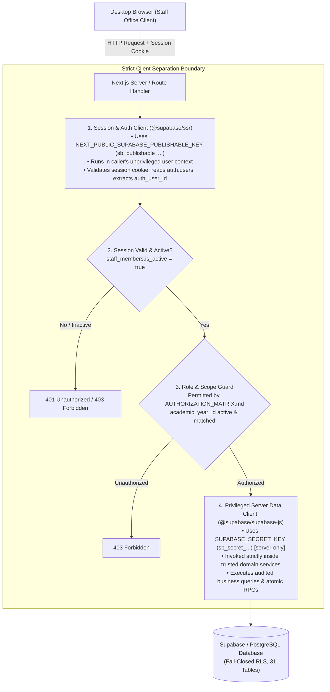
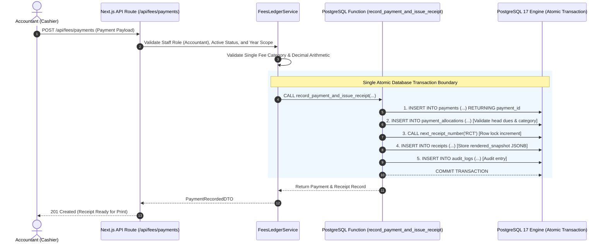

# ADR-001: Architecture Decision Record — Modular Monolith Framework & Security Design

- **Status:** Proposed / Pending Approval
- **Date Created:** 2026-10-26
- **Date Revised:** 2026-10-27 (Post-M0 Repository Audit & M1.1 Finalization)
- **Document Code:** M1.1 — Architecture Decision Record
- **Task Owner:** Shashidhar Pawadashetti (Project Lead & Architecture Owner)
- **Approvers:** 
  - Technical Architecture: Shashidhar Pawadashetti (Project Lead & Architecture Owner)
  - Business & Operational Governance: Rakesh Aralikatti (Client Signatory / Principal)
- **Authoritative Baselines:** Signed BRD v1.4, Signed SRS v1.4 (Approved 22 Oct 2026), Protected Foundation Baseline Commit `5e1c47e`, and Read-Only Repository Audit (`repository_audit_and_execution_plan.md`)

---

## 1. Context & Verified Repository Baseline

### 1.1 Verified Repository Identity & Baseline State
The strictly read-only repository audit conducted on 2026-10-27 established the following facts:
- **Active Task Branch:** `task/m1-1-adr-review` (branched from canonical `main` at `3536bc1933e4e9fc7a7be96d56767b65a994343c`).
- **Protected Foundation Baseline:** Commit `5e1c47e0d85d5dbe54d84b1f3d31b87622e2f3ca` (initial database schema and synthetic demo baseline). This commit represents the foundational database contract and must be preserved without destructive reset or overwrite.
- **Migration Artifact Status (Commit `d768254`):** Commit `d768254` introduced migration file `supabase/migrations/20261022090000_harden_financial_integrity.sql` and test script `supabase/tests/integrity_tests.sql`. This file is an in-tree **migration artifact**; it must **not** be assumed to have been applied to the retained remote database (`fjrfyzamiirqzitdchkz`). Verifying remote migration status belongs to a future dedicated comparison task.
- **Canonical Remote Repository:** `https://github.com/Intallo/Admission-Fee-Management-Portal.git`.
  - *Discrepancy Resolution:* Commit `6cd7998` merged PR #1 from personal fork `Shashidhar-Pawadashetti/task/m0-3-environment-safety`. Early task isolation used the personal fork, whereas the canonical organization repository is `Intallo/Admission-Fee-Management-Portal`, where PRs #2, #3, #4, and remote `origin` reside. Repository history will not be rewritten; all future PRs and documentation reference the canonical `Intallo` organization.
- **Observed Source-Tree Status:** The repository contains complete specifications, database migrations, synthetic demo seed (`supabase/seed.sql`), and generated TypeScript schema types ([`src/types/database.types.ts`](../../src/types/database.types.ts)). It contains **zero application manifests (`package.json`), zero lockfiles, zero build configurations, and zero UI/API code**. Application scaffolding has not yet begun.

### 1.2 Handover and Operational Context
Under signed BRD §2.1 and SRS §1.3:
- **Intallo Deliverable:** Strictly verified **project source code and a handover package** (no hosting or live operations).
- **Client Ownership:** The Client (Rakesh Aralikatti) and ABC English Medium School operate, host, secure, back up, and maintain the production environment.
- **Operational Boundary:** The application runtime must remain minimal, robust, easily containerized, and deployable on a single virtual host without complex distributed microservice infrastructure.

---

## 2. Evaluation of Architecture Options

Two primary architecture candidates were evaluated against project constraints:

| Evaluation Dimension | Option A: Next.js + TypeScript Modular Monolith | Option B: React (Vite) SPA + Node.js (Express) Separate Backend |
|---|---|---|
| **Deployment Complexity** | **Low.** Single unified application package, single runtime process (`node server.js` or standalone Next.js Docker container), single HTTP port. Ideal for Client source-only handover. | **Medium-High.** Two separate codebases/directories, two runtimes, two build pipelines, requiring reverse-proxy configuration (NGINX/Caddy) to avoid cross-domain complexities. |
| **Module Boundaries** | **High.** Feature modules (`src/modules/*`) encapsulate UI pages, domain services, data access adapters, and validation schemas behind clean TypeScript interfaces. | **High.** Physical separation between frontend components and backend Express routers, but requires duplicate domain interfaces or shared monorepo packages. |
| **Type Sharing & Safety** | **Seamless.** Frontend and backend run in a single TypeScript project referencing [`src/types/database.types.ts`](../../src/types/database.types.ts) without monorepo linkers or build steps. | **Moderate.** Requires npm workspace, Turborepo, or symlinking to share database types and DTO definitions between client and server. |
| **Authentication & Session** | **Robust.** Server-side authentication using `@supabase/ssr` with encrypted, HTTP-only cookie sessions. Zero browser token persistence vulnerabilities. | **Moderate.** Requires manual cookie-parsing middleware, JWT verification handlers, CSRF tokens, and refresh token rotation logic in Express. |
| **API & CORS Surface** | **Zero CORS overhead.** UI and API routes share the exact same origin; zero pre-flight latency or cross-origin security misconfigurations. | **CORS Configuration Required.** Must maintain explicit allowed origins, pre-flight handling, and credentials flags across environments. |
| **Private Document Handling** | **High Security.** API Route handlers authenticate staff session, verify student/record scope, and stream file or generate short-lived signed URLs. | **High Security.** Express middleware authenticates session and issues presigned Supabase Storage URLs. |
| **Server-Side PDF Generation** | **Unified.** Generates server-side A4/A5 PDFs via `@react-pdf/renderer` or headless Chrome directly within Route Handlers, streaming buffers to client. | **Unified.** Express endpoints render PDF buffers and stream to client. |
| **Testing Harness** | **Unified Harness.** Single Vitest / Playwright harness covering unit domain logic, API integration routes, and end-to-end browser workflows. | **Fragmented.** Separate test harnesses for Vite (Vitest/Jest) and Express (Supertest/Mocha), plus distinct CI runner jobs. |
| **Maintainability for School IT** | **High.** Single repository, single `package.json`, single command startup (`npm run build && npm start`), deterministic environment variables. | **Lower.** Multi-process monitoring, multiple dependency graphs, and higher likelihood of version drift between API and client. |

### 2.1 Recommendation
**Option A (Next.js + TypeScript Modular Monolith)** is explicitly recommended. It fulfills every requirement of signed BRD v1.4 and SRS v1.4 while minimizing operational moving parts for the Client's post-handover team.

*Trade-Offs of Option A:*
- *Trade-off:* Framework coupling to Next.js App Router conventions.
- *Mitigation:* Domain business logic, financial arithmetic, and state machines are isolated inside framework-agnostic domain services under `src/modules/*`, leaving Next.js App Router strictly as the HTTP/rendering delivery shell.

---

## 3. Database Access, Security & Authorization Specification

### 3.1 Existing Fail-Closed RLS Configuration
The read-only database inventory ([`docs/DATABASE_SCHEMA_INVENTORY.md`](../DATABASE_SCHEMA_INVENTORY.md)) verified:
1. **Row-Level Security (RLS) is enabled** across all 31 public tables (`relrowsecurity = true`).
2. **Fail-Closed Grants:** All privileges on public tables and sequences are explicitly revoked from `public`, `anon`, and `authenticated`.
3. **Current Policy Count = 0:** There are **zero browser-facing RLS policies (`CREATE POLICY`)** in the schema.
4. **Privileges Granted Strictly to `service_role`:**
   ```sql
   grant all on all tables in schema public to service_role;
   grant all on all sequences in schema public to service_role;
   ```

### 3.2 Dual-Client Architecture: Separation of Privileged and SSR Clients
To avoid accidental privilege escalation and ensure strict defense-in-depth, the application strictly separates the **Cookie/Session SSR Client** from the **Privileged Server Data Client**:



#### Key Formatting and Configuration Principles:
1. **Modern Supabase Key Convention:** Prefer Supabase's current `sb_secret_...` key format and server-only `SUPABASE_SECRET_KEY` configuration. For backward compatibility with existing Supabase CLI baselines, fallback to `SUPABASE_SERVICE_ROLE_KEY` is supported.
2. **Zero Client Leakage:** Neither `SUPABASE_SECRET_KEY` nor `SUPABASE_SERVICE_ROLE_KEY` may **ever** be prefixed with `NEXT_PUBLIC_` or bundled in client-facing code.
3. **RLS-Bypass Implications of Elevated Key:** Because the privileged client holds PostgreSQL `BYPASSRLS` privileges, the database engine **will not filter rows or block unauthorized reads/writes at the SQL layer**. Therefore:
   - All tenant/year scoping, active account validation, and role authorization **must** be enforced in server domain guards before issuing queries.
   - Field-level masking of sensitive PII (Aadhaar, income, caste) must be applied programmatically before returning DTOs to callers.

### 3.3 Security, Scoping & Governance Controls
- **Authentication & Identity Linkage:** Authenticate staff email/password via Supabase Auth. The server maps `auth.users.id` -> `public.staff_members.auth_user_id`.
- **Active-Account Check:** Every request validates `staff_members.is_active = true`. Deactivated accounts immediately receive `403 Forbidden`.
- **Role Authorization:** Every domain action checks caller role against `AUTHORIZATION_MATRIX.md` (Principal, Admission Officer, Clerk, Accountant, Read Only).
- **Academic-Year Scoping:** All queries for year-specific entities (`sections`, `student_academic_records`, `fee_assessments`, `transport_assignments`, `receipts`, `student_year_certificates`) must include `WHERE academic_year_id = :active_year_id`. If `academic_years.status = 'closed'`, write mutations are rejected with `422 Unprocessable Entity (Academic Year Closed)`.
- **Audit Logging:** State transitions in admissions, fee adjustments, payments, and certificate releases write an append-only row to `public.audit_logs`.
- **Sensitive Data Protection:** Demographic records in `public.student_sensitive_details` are segregated 1:1, restricted to Principal and ADM, and never logged or exposed to other roles.

### 3.4 Private Storage Architecture
1. **Buckets:** Three private Supabase Storage buckets: `admission-documents`, `receipts`, `certificates`.
2. **Public Access:** Disabled completely.
3. **Presigned Short-Lived URLs:** Files are accessed exclusively via temporary URLs generated server-side with an expiry of **900 seconds (15 minutes)** after verifying user role and student record access.
4. **Audit on Download:** Downloading a student document or reprinting a certificate PDF creates an entry in `public.audit_logs`.

---

## 4. Business and Data-Safety Boundaries

### 4.1 Inviolable Business Invariants (DEC-01 through DEC-12)
1. **Admission Without Mandatory Payment (DEC-01):** Admission approval (`admission_applications.status = 'approved'`) must never require payment. The Admission Fee is variable; no minimum payment gate or forced installment plan is permitted.
2. **Offline Payment Recording Only (DEC-02):** The application is strictly an offline collection recorder. No online payment gateways, wallets, or processor SDKs are in scope.
3. **Shared Monotonic Receipt Numbering (DEC-03):** All receipts (School Fee, Books, Vehicle, Consolidated) draw sequentially from one unified monotonic numbering sequence (`RCT-YYYY-NNNNNN`) managed by `public.issue_receipt_number()`.
4. **Final Fees Receipt at Zero Dues Only (DEC-04):** A numbered Final Fees Receipt is issued strictly when the net balance across all applicable fee heads is ₹0.00. An unnumbered Statement of Account is viewable/printable at any time.
5. **Manager Signature Represents Principal (DEC-05):** Receipt templates require signature lines for Payer, Cashier, and Manager. The Manager is confirmed to be the Principal; Payer signs physically upon printout.
6. **Zero Cross-Year Carry-Forward (DEC-06):** Unpaid balances at academic year-end are never automatically carried forward into the subsequent year's ledger.
7. **Zero Hard Deletes & Immutable Ledger (DEC-07):** Database triggers (`private.prevent_hard_delete`, `private.reject_immutable_update`) enforce zero hard-deletes across 21 core tables. Financial corrections use approved reversal transactions.
8. **Annual LC/TC Independent of Left Status (DEC-08):** LC/TC records are generated annually per student academic record. Generating an LC/TC does not mark a continuing student as "Left" or "Transferred".
9. **Single Fee Category per Payment (DEC-10):** Every payment belongs to exactly one `fee_category` (`school_fee`, `vehicle`, `books`). Allocations cannot cross categories within a single payment.
10. **Exact Decimal Monetary Arithmetic (DEC-11):** All currency calculations use exact decimal INR arithmetic (`numeric(10,2)` in DB; integer paise or `decimal.js` in Node.js). Floating-point math (`float`, `double`) is strictly banned.

### 4.2 Multi-Step Financial Workflow Consistency & Atomic Database RPC
Because separate web HTTP requests cannot form a single database transaction, multi-step financial collection operations must be executed as a **single atomic database transaction**.



#### Database Function Specification for Future Implementation (Milestone M5.2):
The atomic financial transaction will be encapsulated in a dedicated stored procedure / RPC with explicit security hardening:
- **Function Ownership:** Owned by `postgres` (or trusted database administrator).
- **Execution Context:** Defined as `SECURITY DEFINER` to guarantee atomic sequence locking and cross-table allocation checks.
- **Search Path Protection:** Must explicitly declare `SET search_path = public, pg_temp;` to eliminate search_path hijacking vulnerabilities.
- **Strict Privilege Grants:**
  ```sql
  REVOKE ALL ON FUNCTION public.record_payment_and_issue_receipt(...) FROM PUBLIC;
  REVOKE ALL ON FUNCTION public.record_payment_and_issue_receipt(...) FROM anon;
  REVOKE ALL ON FUNCTION public.record_payment_and_issue_receipt(...) FROM authenticated;
  GRANT EXECUTE ON FUNCTION public.record_payment_and_issue_receipt(...) TO service_role;
  ```
- *Boundary Statement:* The schema change and SQL implementation of this function belong strictly to **Milestone M5.2**; zero database functions or migrations are created as part of this M1.1 ADR task.

---

## 5. Environment Boundary, Testing & Rollback Strategy

### 5.1 Environment Boundary & Protection of Retained Database
- **Retained Remote Database (`fjrfyzamiirqzitdchkz`):** Strictly protected. No development server, local script, reset command (`supabase db reset`), or migration execution will be directed against this project reference.
- **Disposable Local Database Only:** All development, integration testing, and negative constraint testing must execute against a local disposable container (`supabase start` on local Docker).
- **Tooling Prerequisite:** Supabase CLI is missing on the host PATH (`SETUP.md`). It is recorded strictly as a **mandatory prerequisite for the later disposable-local-database test task (M2.3)**, **not** as permission or reason to run database commands against the retained database now.

### 5.2 Negative Testing Strategy
Before any pull request is merged, the following automated negative verification suites must execute against the local disposable database:
1. **Financial Boundary Tests:**
   - Attempt payment allocation exceeding remaining head balance -> must reject (`validate_payment_allocation`).
   - Attempt multi-category allocation within a single payment -> must reject (`enforce_single_category_per_payment`).
   - Attempt payment insertion where allocation sum != payment amount -> must reject (`assert_payment_allocation_sum`).
2. **Access Control Negative Tests:**
   - Attempt admission approval by non-Principal (e.g. Clerk or SYSADMIN) -> must return `403 Forbidden`.
   - Attempt fee concession creation without Principal approval -> must remain `pending` or reject.
   - Attempt query for sensitive PII (`student_sensitive_details`) by Accountant -> must return `403 Forbidden` / omitted fields.
3. **Data Immutability Tests:**
   - Attempt `DELETE` on any of the 21 protected tables -> must throw PostgreSQL hard-delete rejection.
   - Attempt `UPDATE` on committed `payments`, `payment_allocations`, or `receipts.rendered_snapshot` -> must reject.

### 5.3 Rollback and Recovery Plan
- **Architecture and Documentation:** Reversible via Git history (`git revert` or reset to `3536bc1`).
- **Database Migrations (Future):** Every forward migration file (`*.sql`) must be accompanied by an audited rollback script (`*.down.sql`) verified on local Docker before PR submission.
- **Application Deployment:** Handover package includes a containerized Dockerfile and standalone Node output capable of zero-downtime blue/green deployment and single-command rollback.

---

## 6. Revision History & Gating Approvals

### 6.1 Revision History
| Revision | Date | Author | Summary of Changes |
|---|---|---|---|
| 1.0 | 2026-10-26 | Shashidhar Pawadashetti | Initial architectural proposal and evaluation criteria. |
| 1.1 | 2026-10-27 | Shashidhar Pawadashetti | Post-M0 audit revision: verified foundation baseline `5e1c47e`, resolved `Intallo` canonical remote, evaluated Options A & B, established server-side mediation model, defined dual-client separation, modern `SUPABASE_SECRET_KEY` convention, atomic financial RPC specifications, search_path protections, and migration artifact status for commit `d768254`. |

### 6.2 Gating Approvals Required to Close M1
This architecture record remains in **`Proposed / Pending Approval`** status until the following formal approvals are provided:

1. **Technical Architecture Approval:**  
   *Shashidhar Pawadashetti (Project Lead & Architecture Owner)*  
   Decision: Formally approve Option A modular monolith framework, dual-client separation, and atomic database transaction boundary.
2. **Client Business & Governance Approval:**  
   *Rakesh Aralikatti (Client Signatory / Principal)*  
   Decision: Formally ratify Section 3.3 role authority matrix (Principal institutional authority vs. SYSADMIN technical operator restriction).

### 6.3 Downstream Milestone Unblocking
Upon formal acceptance of ADR-001:
- **Milestone M1.2:** Define explicit TypeScript domain module interfaces (`src/modules/*`).
- **Milestone M1.3:** Author strongly-typed API and error contracts (`API_SPEC.md`).
- **Milestone M1.4:** Finalize private document and PDF generation design.
- **Milestone M2.1:** Scaffold Next.js application manifest (`package.json`), TypeScript configuration (`tsconfig.json`), and folder hierarchy.
